# Repoute

**Repoute = Repo + Route.** GitHub URL 을 넣으면 어디서부터 읽을지(읽기 지도), 코드가 어떻게 흐르는지(따라가기), 어떤 이슈·PR 부터 보면 좋을지를 `파일:줄` 근거와 함께 안내하는, 오픈소스 기여를 처음 시작하는 개발자를 위한 AI Agent.

> v2. FastAPI(SSE) + Vite/React 단일 채팅 화면. Python 레포만 지원.

## 주요 기능

| 기능 | 하는 일 |
|---|---|
| **읽기 지도** | 진입점과 추천 읽기 순서. 핵심 모듈은 import 그래프 랭킹에서 고른다 |
| **따라가기** | 질문 하나로 호출 체인을 따라가며 읽은 코드만 인용한다. 함수 이름이 없는 질문은 심볼 임베딩 검색으로 출발점을 찾는다 |
| **다음 단계** | "다음", "3단계까지 봤어" 로 지도의 다음 단계를 하나씩 짚는다 (LLM 없음) |
| **Issue Matcher** | 프로필(관심 영역·수준)에 맞는 열린 이슈와 읽을 모듈·코드 위치를 추천한다. 프로필이 없으면 멈추고 묻는다 |
| **PR Coach** | PR 의 변경 심볼 → 호출자(영향 범위) → 관련 테스트 → 리뷰 체크포인트를 인용과 함께 정리한다 |
| **코드 뷰어 · 설명 패널** | 인용을 누르면 그 줄을 감싼 심볼과 한국어 요약, "꼭 봐야 할 코드" 줄을 보여 준다 |

## 화면

**레포 불러오기 → 읽기 지도 → 근거 위치(`파일:줄`)를 눌러 코드와 설명 보기**

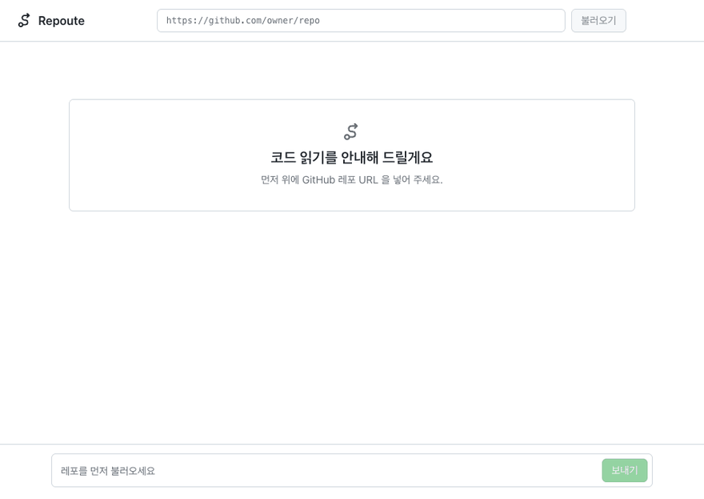

**함수 이름 없이 묻기 — 질문 문장만으로 `merge_cookies` 까지 따라간다**


**함수 이름을 몰라도 질문할 수 있다.** "세션 쿠키와 요청 쿠키는 어디서 합쳐져?" 처럼 동작만 설명하면, 함수마다 의미를 벡터로 저장해 둔 심볼 임베딩에서 가장 비슷한 함수를 찾아 거기서부터 코드를 따라간다. 답의 근거는 모두 실제로 읽은 `파일:줄` 이다. 함수 이름 없는 질문 10개 중 6개에서 정답 코드까지 도달했다(이전 0개).

| 읽기 지도 | 따라가기 |
|---|---|
| 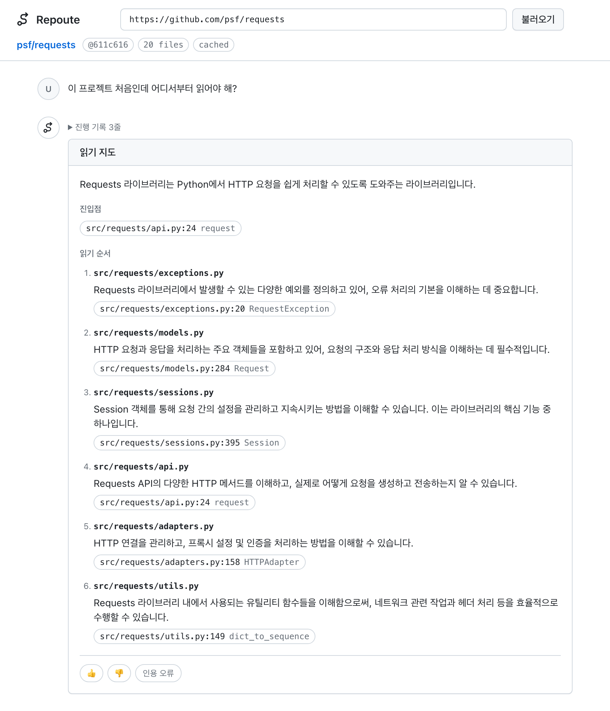 | 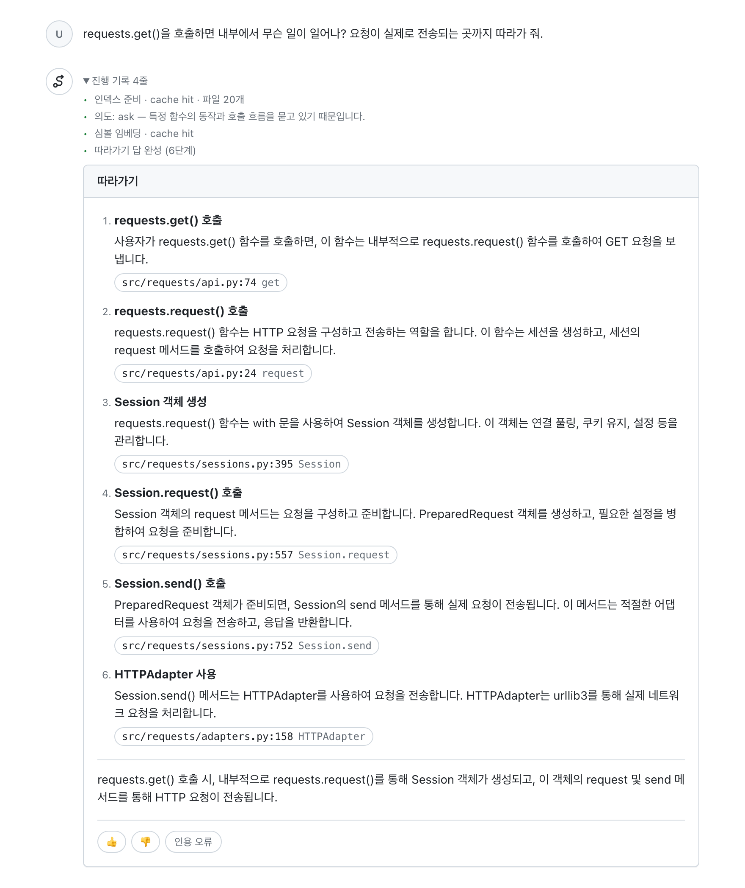 |
| 진입점과 읽기 순서. 평균 7.6s · $0.022 (레포 5개)<br/> | `requests.get()` → `Session.send` → `HTTPAdapter`. quality 모델, 평균 14.4s (질문 20개)<br/> |
| **Issue Matcher** | **PR Coach** |
| 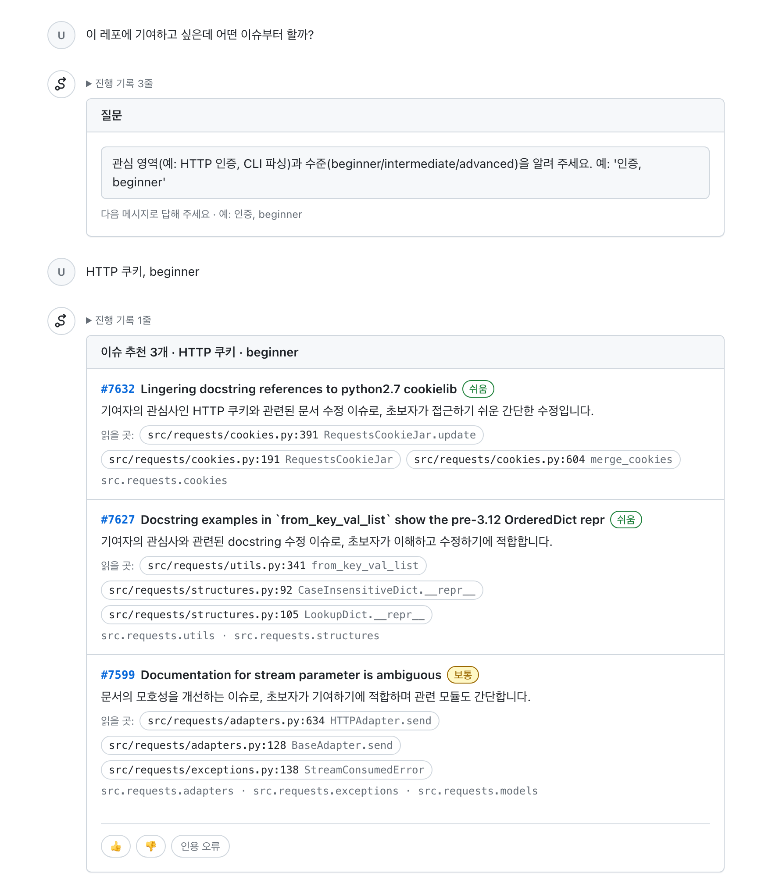 | 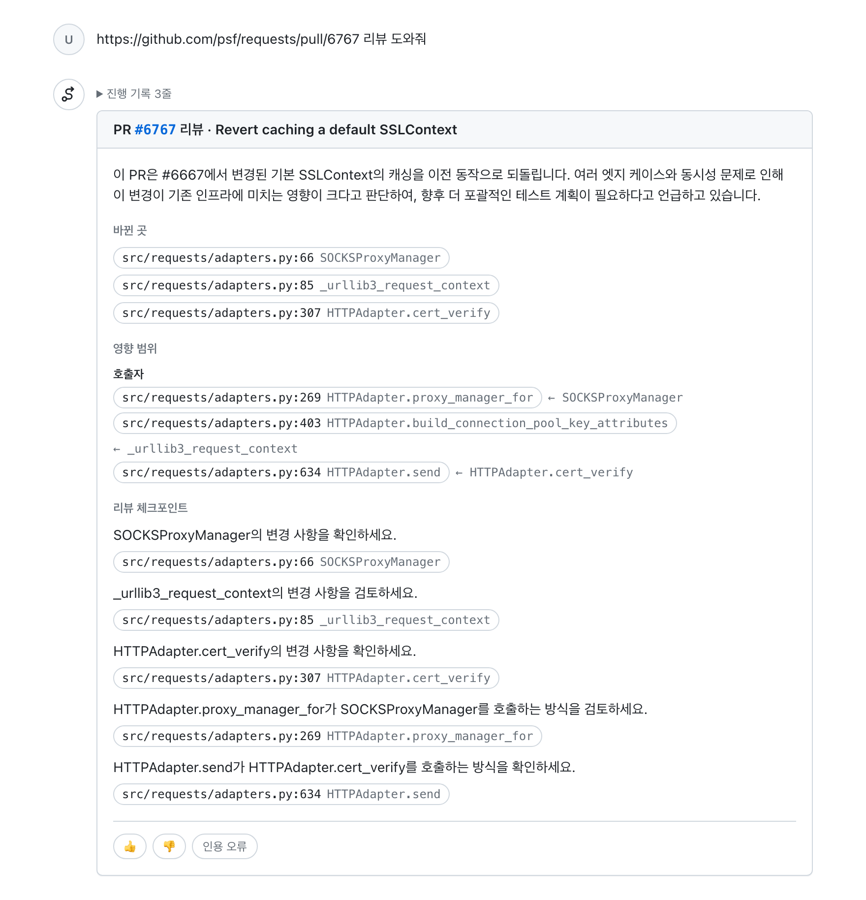 |
| 프로필이 없으면 그래프가 멈추고 묻는다(interrupt). GitHub MCP + 임베딩 매칭, $0.0003 | PR #6767 의 바뀐 심볼 → 호출자 → 체크포인트. $0.0004 |

## 핵심 수치

| 지표 | 전 → 후 | n |
|---|---|---|
| 읽기 지도 핵심 모듈 precision@5 | 0.32 → **0.72** | 레포 5 |
| 따라가기 인용 엄격 통과 (존재 + 실제로 읽은 범위 안) | 65% → **100%** | 질문 20 |
| 함수 이름 없는 질문 따라가기 도달 | 0/10 → **6/10** | 질문 10 |
| 이슈 → 모듈 매칭 p@3 | **0.85** | 이슈 20 |
| PR 영향 범위 재현 | 36% → **64%** | PR 8 |
| MCP 도구 설명 토큰 | 12.8k → **1.2k** (−91%) | — |
| 비용 | 읽기 지도 레포당 **$0.022**, 따라가기 질문당 **$0.083** (quality) | 5 · 20 |

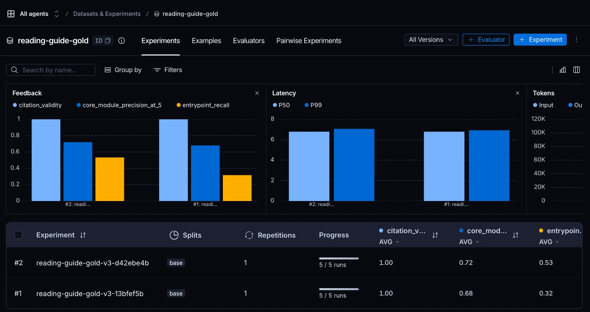

같은 gold 레포 5개로 돌린 LangSmith Experiment 두 개다. #1 `…-13bfef5b`(기록 18, 랭킹 v2) → #2 `…-d42ebe4b`(기록 20, 진입점 v3): 프롬프트는 그대로 두고 정적 입력만 바꿔 진입점 recall 0.32 → 0.53, 핵심 모듈 p@5 0.68 → 0.72.

## 아키텍처

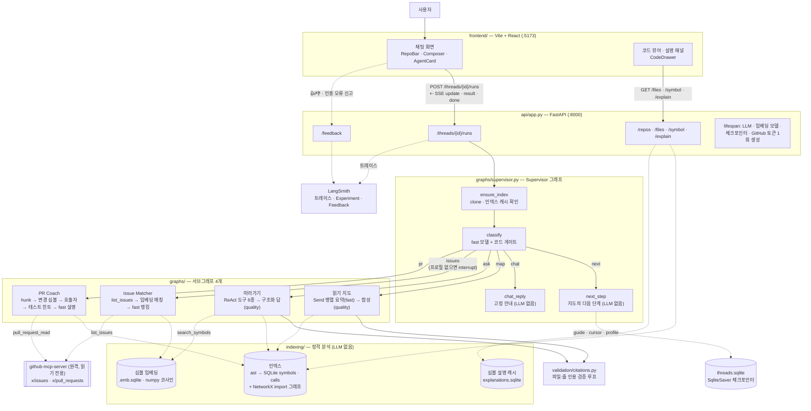

- **계층형 그래프 (supervisor pattern)**: 프론트는 메시지마다 `POST /threads/{id}/runs` 하나만 부른다. Supervisor 가 의도 6종(map · ask · next · chat · issues · pr)을 분류해 서브그래프 4개로 보낸다. 자율 에이전트의 협상이 아니라 **라우터 + 서브그래프 + `Send` 병렬 + interrupt** 다.
- **근거는 정적 분석, LLM 은 설명**: 함수 · 클래스 · import · 호출 관계는 `ast` 로 뽑아 SQLite · NetworkX 에 둔다. LLM 이 낸 `파일:줄` 인용은 검증 루프가 확인하고, 남은 오류는 숨기지 않고 표시한다.
- **캐시와 LLM 없는 경로**: 인덱스 · 임베딩은 `repo@commit` 단위로 캐시한다. `next` · `chat` · 코드 뷰어는 LLM 을 부르지 않는다.
- **MCP 는 노드가 직접 호출**: github-mcp-server 도구를 LLM 에 바인딩하지 않고, 읽기 전용 도구만 정해진 인자로 1~2회 부른다.
- **대화 상태는 체크포인터에**: 지도 · 커서 · 최근 대화 · 프로필이 `threads.sqlite` 에 남아 후속 질문을 이어 간다.

노드 · 상태 · 저장소 · 비용 상한은 [docs/architecture.md](docs/architecture.md).

### LangSmith 트레이스

모든 LLM · 도구 호출은 LangSmith 에 남는다. 아래는 위 화면을 녹화할 때의 실제 트레이스다(프로젝트 `repoute-dev`).

| 읽기 지도 — `Send` 병렬 | 따라가기 — ReAct 도구 호출 | PR Coach — MCP 직접 호출 |
|---|---|---|
| 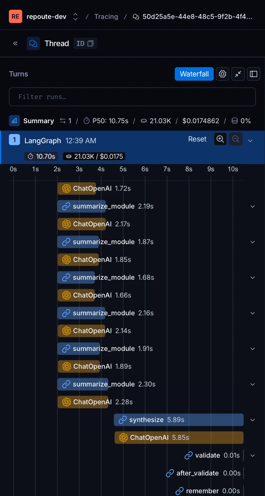 | 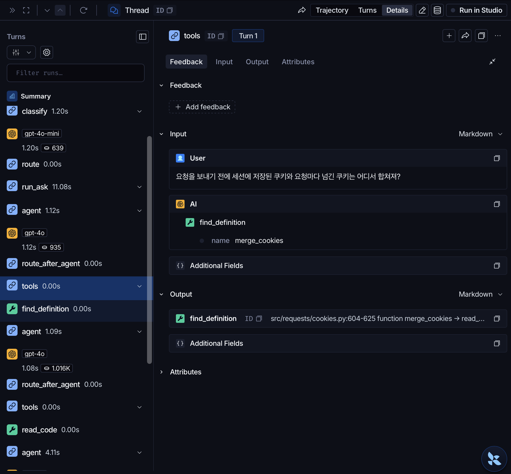 | 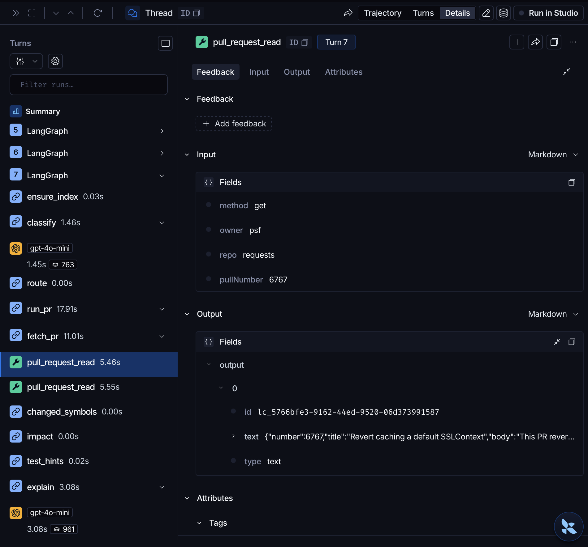 |
| `summarize_module`(fast) 이 모듈 수만큼 같은 시점에 시작하고, 끝나면 `synthesize`(quality) 1회 → `validate`. 10.7s · 21.0K 토큰 · $0.0175 | `classify`(gpt-4o-mini) → `run_ask` 안에서 `agent`(gpt-4o) ⇄ `tools`. `find_definition` 결과가 `파일:줄 → read_code(...)` 힌트를 함께 돌려준다 | `fetch_pr` 아래 `pull_request_read` 2회(get · get_files)를 노드가 정해진 인자로 부르고, LLM 은 마지막 `explain`(gpt-4o-mini) 1회뿐 |

| 영역 | 사용 기술 |
|---|---|
| 언어·패키지 | Python 3.11, uv |
| LLM | LangChain `init_chat_model` (openai 기본: fast gpt-4o-mini / quality gpt-4o, anthropic·ollama 는 설정만) |
| 에이전트 그래프 | LangGraph (`Send` 병렬, `interrupt`/`Command(resume)`, `SqliteSaver` 체크포인터) |
| 트레이싱·평가 | LangSmith (`evaluate()` Experiment, Feedback) |
| 정적 분석 | `ast`, `sqlite3`, `networkx` (+ `scipy`) |
| 임베딩 검색 | `text-embedding-3-small` + SQLite 저장 · numpy 코사인 |
| GitHub 연동 | `langchain-mcp-adapters` → 원격 github-mcp-server (`x/issues/readonly`, `x/pull_requests/readonly`) |
| API · 프론트 | FastAPI + SSE · Vite + React + TypeScript |
| 품질·CI | ruff, pytest, vitest, GitHub Actions |

## 주요 유스케이스

### 1. 레포 열기와 읽기 지도 (map)

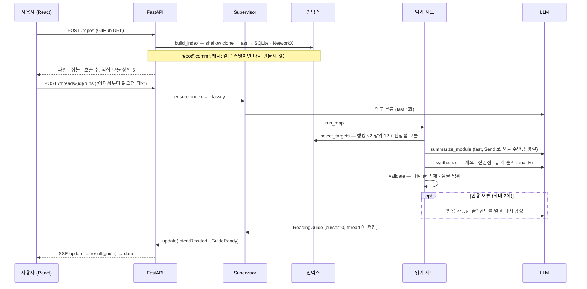

### 2. 따라가기 — 함수 이름 없는 질문 (ask)

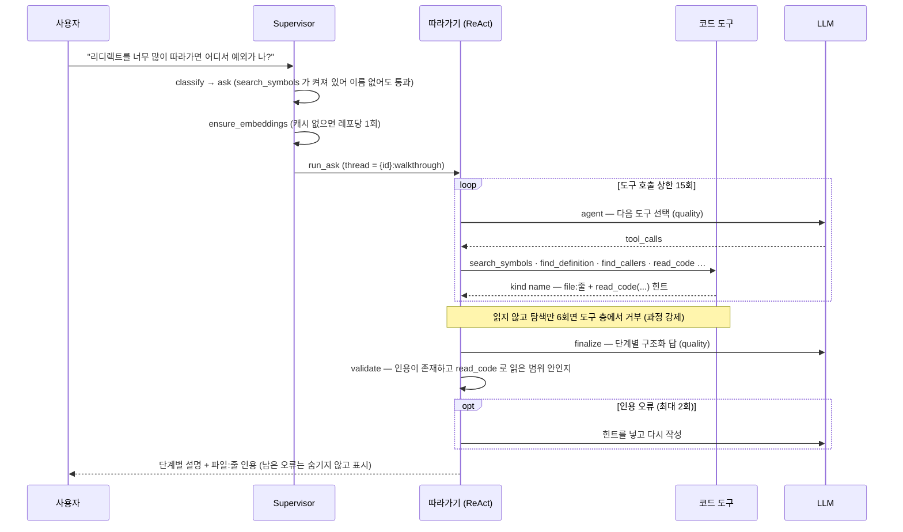

### 3. 이슈 추천 — 프로필 질문으로 멈췄다 재개 (issues)

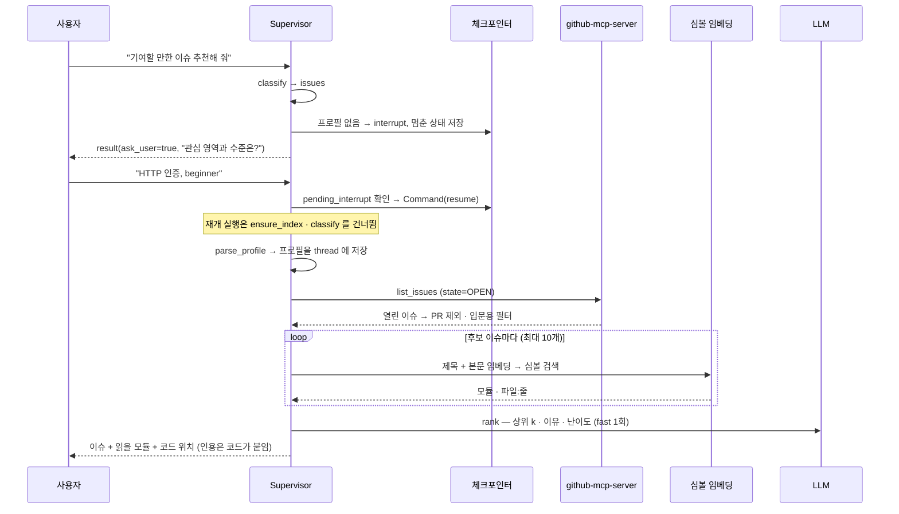

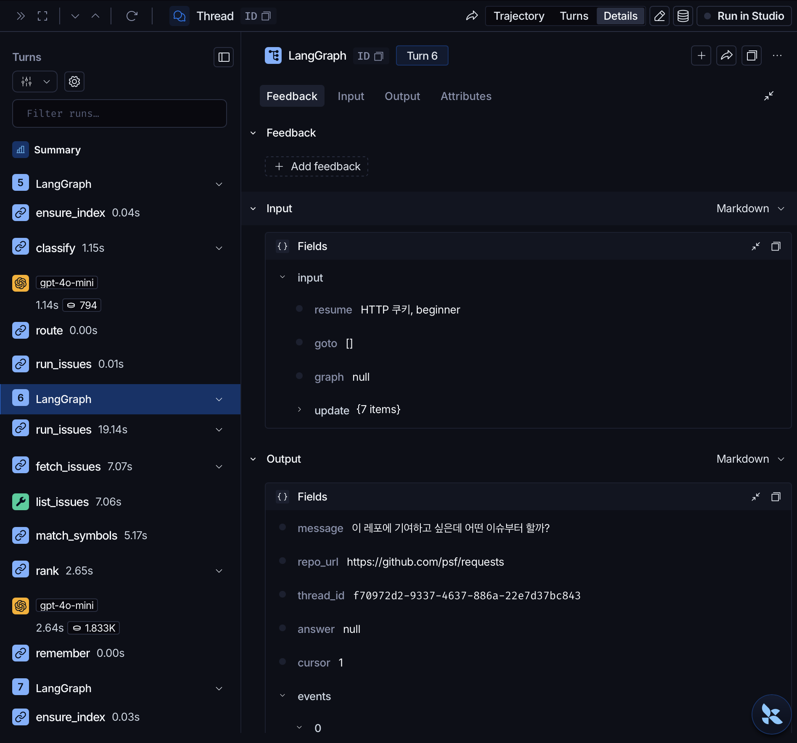

같은 스레드의 두 턴이다. Turn 5 는 `run_issues` 가 0.01s 만에 interrupt 로 멈추고, Turn 6 은 입력이 `Command(resume="HTTP 쿠키, beginner")` 라 `ensure_index` · `classify` 없이 `run_issues` 부터 이어서 `list_issues`(MCP) → `match_symbols`(임베딩) → `rank`(gpt-4o-mini 1회) 를 실행한다.

### 4. PR 리뷰 안내 (pr)

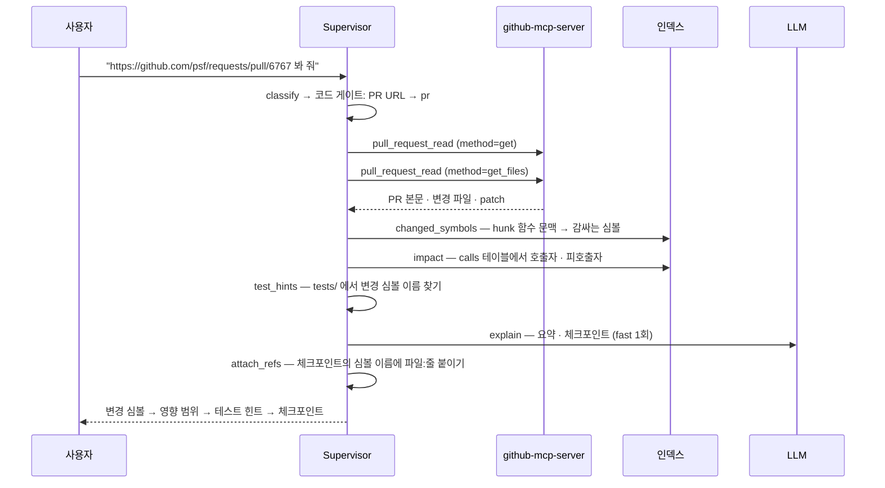

## 설계 판단

- **개선은 프롬프트가 아니라 정적 입력에**: 같은 프롬프트에서 모듈 랭킹만 바꿔 p@5 0.32 → 0.68. LLM 은 입력 순서를 거의 바꾸지 않았다.
- **제약은 지시가 아니라 입력 · 도구 층으로**: 문장으로 지시한 규칙은 지켜지지 않았고, 같은 제약을 입력 데이터나 도구 거부로 주면 지켜졌다(7회 확인).
- **과정 강제**: 읽지 않고 탐색만 6회 하면 도구 층에서 거부해 인용 엄격 통과 65% → 100%. 대가는 답의 깊이였다.
- **지표는 나눠 잰다**: 인용 유효성만 고치자 인용이 `파일:1` 로 쏠렸다(유효성 100%, 구체성 43%). 유효성 · 구체성 · 완결성을 따로 잰다.

## 한계

- **n 이 작다**: gold 레포 5개, 질문 20 + 10개, 이슈 20개, PR 8개. 정답 라벨 대부분이 사용자 검수 전이다.
- **Python 만**: `ast` 기반이고, 호출은 이름 기준이라 `a.save()` 와 `b.save()` 를 구분하지 못한다.
- **PR 체크포인트 문장이 일반적**이고, 테스트 힌트는 이름 텍스트 검색이다.
- **실제 기여로는 아직 검증하지 않았다**: 효과는 gold 데이터셋 지표로만 쟀다.

## 실행 방법

```bash
uv sync
cp .env.example .env          # OPENAI_API_KEY, LANGSMITH_API_KEY, GITHUB_PERSONAL_ACCESS_TOKEN 입력
uv run repoute check          # LLM 연결 확인 (핑 1회)
```

`GITHUB_PERSONAL_ACCESS_TOKEN` 은 Issue Matcher · PR Coach 에만 필요하다(Public repositories 읽기 전용, Issues · Pull requests 읽기 권한).

API + 프론트 (터미널 두 개):

```bash
uv run repoute-api                              # http://127.0.0.1:8000 (문서: /docs)
cd frontend && npm install && npm run dev       # http://localhost:5173
```

CLI :

```bash
uv run repoute index https://github.com/psf/requests                           # 인덱싱만, LLM 없음
uv run repoute map https://github.com/psf/requests                             # $ 읽기 지도, 약 $0.02
uv run repoute ask https://github.com/psf/requests "requests.get()은 내부에서 뭘 해?"  # $ 따라가기, 약 $0.08
uv run repoute issues https://github.com/psf/requests --interests "HTTP 인증"    # $ 이슈 추천, 약 $0.0004
uv run repoute pr https://github.com/psf/requests/pull/6767                    # $ PR 리뷰 안내, 약 $0.0003
```

테스트 :

```bash
uv run pytest
cd frontend && npm test
```

평가 스크립트와 옵션(`--agent-model`, `--search-symbols`, `--thread` 등)은 [docs/evaluation.md](docs/evaluation.md) 와 `uv run repoute --help`.

## 디렉토리 구조

```
Repoute/
├── src/repoute/
│   ├── cli.py              # CLI — check · index · map · ask · issues · pr
│   ├── api/                # FastAPI + SSE (app.py)
│   ├── graphs/             # supervisor · reading_guide · walkthrough · issue_matcher · pr_coach
│   ├── indexing/           # 정적 분석 — clone · ast 파싱 · import 그래프 랭킹 · 진입점 · 임베딩 · 심볼 설명
│   ├── tools/              # 따라가기 도구 (find_definition · read_code · search_symbols …)
│   ├── validation/         # 파일:줄 인용 검증
│   ├── github/             # github-mcp-server 연결 · 이슈 · PR 파싱
│   ├── memory/             # SqliteSaver 체크포인터
│   └── prompts/            # 버전별 프롬프트
├── frontend/src/           # Vite + React 채팅 화면 · 코드 뷰어
├── tests/                  # pytest (가짜 LLM)
├── evals/                  # datasets · evaluators · experiments · results
└── docs/                   # 아래 문서
```

## 문서

- [docs/architecture.md](docs/architecture.md): 그래프 5개 · 상태 · 저장소 · GitHub MCP · 비용 상한
- [docs/design-decisions.md](docs/design-decisions.md): 설계 판단과 근거 실험
- [docs/evaluation.md](docs/evaluation.md): 전체 수치 · 데이터셋 · 평가자 · 실패 사례와 한계
- [docs/troubleshooting.md](docs/troubleshooting.md): 겪은 문제 (증상 → 원인 → 해결 → 교훈)
- [docs/conventions.md](docs/conventions.md): Git 운영 · 측정 기록 · CI 회귀 평가 규칙
- [evals/results/README.md](evals/results/README.md): 실험 기록 전체
