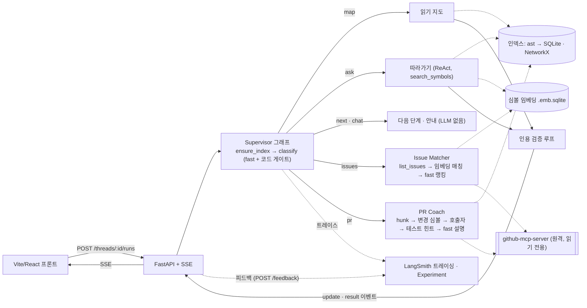

# Repoute

**Repoute = Repo + Route.** GitHub URL 을 넣으면 어디서부터 읽을지(읽기 지도), 코드가 어떻게 흐르는지(따라가기), 어떤 이슈·PR 부터 보면 좋을지를 `파일:줄` 근거와 함께 안내하는, 오픈소스 기여를 처음 시작하는 개발자를 위한 AI Agent.

> 2026-10-21 v2. Phase 0~7(인덱싱 · 읽기 지도 · 따라가기 · 평가 · UI · Issue Matcher · PR Coach) 구현. FastAPI(SSE) + Vite/React 단일 채팅 화면. Python 레포만 지원한다.

기능:

- **읽기 지도**: 진입점과 추천 읽기 순서. 핵심 모듈은 import 그래프 랭킹에서 고른다.
- **따라가기**: 질문 하나로 호출 체인을 따라가며 읽은 코드만 인용한다. 이제 **함수 이름이 없는 질문도** 받는다 — 심볼 임베딩 검색(`search_symbols`)으로 출발점을 찾는다.
- **다음 단계**: "다음", "3단계까지 봤어" 로 지도의 다음 단계를 하나씩 짚는다. LLM 없음.
- **Issue Matcher**: GitHub MCP 로 열린 이슈를 받아, 프로필(관심 영역·수준)에 맞는 이슈와 읽을 모듈·코드 위치를 추천한다. 프로필이 없으면 그래프를 멈추고(interrupt) 묻는다. 이슈 → 코드 매칭은 임베딩 검색.
- **PR Coach**: PR 하나의 변경 심볼 → 호출자(영향 범위) → 관련 테스트 힌트 → 리뷰 체크포인트를 인용과 함께 정리한다.
- **코드 뷰어 · 설명 패널**: 인용을 누르면 그 줄을 감싼 심볼을 열고, docstring 한국어 요약과 "꼭 봐야 할 코드" 줄을 보여 준다.

## 핵심 수치

모든 수치는 `evals/results/` 에 기록한 측정값이다. 기록 번호는 `evals/results/NN-*.md`.

| 지표 | 전 → 후 | n · 방법 | 기록 |
|---|---|---|---|
| 읽기 지도 핵심 모듈 precision@5 | 0.24 (정적 PageRank) → **0.72** (LLM 출력) | 레포 5개, gold 대비 결정론적 채점 | 14 → 18~20 |
| 읽기 지도 진입점 recall | 0.05 (정적 휴리스틱) → **0.53** (LLM 출력) | 같음. LLM 출력 기준 시작점은 0.27 (16) | 14 → 20 |
| 읽기 지도 인용 유효성 | **100%** (구체성 100%, 재생성 0) | 레포 5개, 사후 검증 | 06 · 20 |
| 따라가기 인용 엄격 통과 | 65% → **100%** | 질문 20개, 그래프 검증(존재 + 읽은 범위 안) | 10 → 12 |
| 이름 없는 질문 따라가기 도달 | UI 경로 0/10 → **6/10** (끝 이름 8/10), 질문당 $0.060 → **$0.045** | 질문 10개, 자동 도달 판정 | 23 → 24 |
| Supervisor 의도 분류 정확도 | LLM **97%** / 게이트 후 93% | 메시지 30개 | 22 |
| 설명 패널 "꼭 봐야 할 코드" | 카테고리 라벨 복사 v1 56/56 → v2 **0/82**. 후처리로 문제 항목 19 → 9 | 심볼 20개, 결정론적 지표 | 22 |
| 이슈 → 모듈 매칭 | p@3 **0.85**, hit@3 **0.90** (임베딩만, $0.00006) | 이슈 20개 | 25 |
| MCP 도구 설명 토큰 | 12.8k → **1.2k** (−91%, 읽기 전용 toolset + 이름 필터) | tiktoken `o200k_base` | 25 |
| PR 영향 범위 | 재현 36% → **64%**, 정밀 9% → **40%** (hunk 함수 문맥 우선, 피호출자 제외) | PR 8개, LLM·MCP 0 | 26 |
| 읽기 지도 비용 | 레포당 **$0.022**, 7.6s | 레포 5개, 토큰 × 단가 추정 (LangSmith 교차: 레포당 약 $0.02, 18·20) | 06 |
| 따라가기 비용 | 질문당 fast **$0.018** / quality **$0.083** | 질문 20개, LangSmith 트레이스 합 | 12 · 13 |

- 읽기 지도 정확도 향상은 **프롬프트를 바꾸지 않고** 정적 입력(진입점 후보 v2·v3, 역방향 개인화 PageRank 랭킹 v2)만 고쳐서 얻었다(15·17·19).
- 따라가기 인용 통과율은 "코드를 읽기 전에는 답하지 못하게" 하는 과정 강제(탐색 상한)로 올렸다(12).
- 이름 없는 질문의 가장 큰 효과는 도구 자체(게이트 우회 시 5 → 6/10)보다 **도구가 생겨 게이트를 열 수 있게 된 것**(UI 경로 0 → 6/10)이다(24).
- 아래에서 쓰는 **"도달" 은 자동 근사치**다: 기대 심볼의 끝 이름이 답의 단계 제목·설명·인용 심볼에 들어 있는지를 문자열로 본다(기록 14 의 끝 이름 매칭). 기록 10~13 의 값은 사람이 한 번 훑어 보정했지만 체계적인 사람 평가는 아니다.

## 아키텍처

설계 원칙:

- **정적 분석 + LLM 하이브리드**: 함수·클래스·import·호출 관계는 Python `ast` 로 추출해 SQLite·NetworkX 에 저장한다. LLM 은 추출된 구조를 해석하는 데만 쓴다.
- **`파일:줄` 인용 검증**: 인용이 실제로 존재하는지, 심볼 범위 안인지, (따라가기는) 실제로 읽은 범위 안인지 검사하고 실패하면 "대신 인용할 수 있는 줄" 힌트를 넣어 다시 생성한다. 남은 오류는 숨기지 않고 표시한다. Issue Matcher·PR Coach 는 LLM 출력에 인용 칸을 두지 않고, 정적 결과의 인용을 코드가 붙인다.
- **`repo@commit` 단위 캐시**: 같은 커밋은 다시 인덱싱·임베딩하지 않는다.
- **LangSmith 평가**: 모든 LLM 호출을 트레이싱하고, 변경마다 전 → 후를 데이터셋과 평가자로 기록한다.
- **사람이 코드를 쓴다**: 도구는 안내와 검토만 한다.
- **계층형 그래프(supervisor pattern)**: Supervisor 그래프가 의도(map·ask·next·chat·issues·pr)를 분류해 서브그래프를 호출한다. 자율 에이전트들이 협상하는 멀티 에이전트가 아니라 **라우터 + 서브그래프 4개 + `Send` 병렬 + interrupt** 다. 후속 질문은 thread 체크포인터의 상태(지도·커서·대화 기억·프로필)로 LLM 없이 답하는 경우가 많다.



그래프 5개(Supervisor + 읽기 지도 · 따라가기 · Issue Matcher · PR Coach)의 노드·상태·저장소·비용 상한은 [docs/architecture.md](docs/architecture.md).

| 영역 | 사용 기술 |
|---|---|
| 언어·패키지 | Python 3.11, uv |
| LLM | LangChain `init_chat_model` (openai 기본: fast gpt-4o-mini / quality gpt-4o, anthropic·ollama 는 설정만) |
| 에이전트 그래프 | LangGraph (`Send` 병렬, `interrupt`/`Command(resume)`, `SqliteSaver` 체크포인터) |
| 트레이싱·평가 | LangSmith (`evaluate()` Experiment, Feedback) |
| 정적 분석 | `ast`, `sqlite3`, `networkx` (+ `scipy`) |
| 임베딩 검색 | `text-embedding-3-small` + SQLite 저장 · numpy 코사인 (벡터 DB 없음) |
| GitHub 연동 | `langchain-mcp-adapters` → 원격 github-mcp-server (`x/issues/readonly`, `x/pull_requests/readonly`) |
| API · 프론트 | FastAPI + SSE · Vite + React + TypeScript |
| 품질·CI | ruff, pytest, vitest, GitHub Actions |

## 설계 판단

**1. 정적 분석 + LLM 하이브리드 (E1: 16·18).** LLM 은 입력의 순서를 재배열하지 않았다. PageRank 상위를 넣으면 읽기 순서가 PageRank 순서 그대로였고 p@5 는 0.32(정적 0.24)에 그쳤다(16, n=5). 랭킹만 v2 로 바꾸자 같은 프롬프트로 0.68(18, n=5). 그래서 개선은 프롬프트가 아니라 정적 입력에 투자했다. 기획서의 "LLM 단독" 비교군은 측정하지 않았다.

**2. 인용 검증 루프의 실제 효과 (E4: 03).** 가설 "검증 루프가 환각을 줄인다"는 지지되지 않았다. 유효성 naive 97% / validate 97%, 비용 $0.021 → $0.029(n=5). 유일한 실패(fastapi `__init__.py:0`)는 피드백이 "무엇이 틀렸는지"만 말해 재생성 2회에도 고쳐지지 않았다. 피드백에 "인용 가능한 줄" 힌트를 넣었고, 루프는 정확도 장치가 아니라 틀린 인용을 내보내지 않는 안전장치로 남겼다.

**3. 허용 범위는 지시가 아니라 입력으로.** 문장으로 지시한 프롬프트 v2 는 지켜지지 않았고(04), 같은 제약을 입력 데이터로 주면 지켜졌다. 일곱 번 확인했다.

| 기록 | 입력으로 준 것 | 결과 |
|---|---|---|
| 05·06 | 심볼 있는 파일의 인용 가능 목록에서 줄 1 제거 | 구체성 43% → 100% (n=1), 5개 레포 100% (n=5) |
| 08 | `find_definition` 결과에 `→ read_code(file, start, end)` 힌트 | 20줄 분할 읽기 0회, `Session.send` 까지 도달 (n=1) |
| 09 | `인용: file:line_start` 힌트 | def 줄 인용 0% → 100% (n=1) |
| 12 | 읽기 없이 탐색 6회면 도구 층에서 거부 | 엄격 통과 65% → 100% (n=20) |
| 18 | 역방향 개인화 PageRank 랭킹 | 핵심 모듈 p@5 0.32 → 0.68 (n=5) |
| 24 | `search_symbols` 결과 `kind name — file:줄` + `read_code(...)` 힌트 | 첫 read_code 까지 호출 3.2 → 2.0, 도달 5 → 6/10 (n=10) |
| 26 | git hunk 헤더의 함수 문맥(이름)을 줄 번호보다 먼저 | 변경 심볼 재현 28% → 56% (n=8) |

**4. 지표 분리: 유효성 · 구체성 · def 줄 · 완결성.** 유효성만 고치자 fastapi 인용 7개 중 5개가 `파일:1` 로 쏠렸다 — 유효성 100%, 구체성 83% → 43%(04, Goodhart). 구체성 지표를 추가하고 입력을 막아 100% 로 되돌렸다(05). 인용이 함수 마지막 줄을 가리키는 문제는 `citation_at_def` 로 잡았다(08 → 09). 흐름 완결성은 따로 잰다: 엄격 통과 100% 인 12 에서도 도달은 4/20(수동 보정)이었다. 체인 정확도는 fast 0.49 / fast+탐색 상한 0.28 / quality 0.60(14, n=20).

**5. 모델 급 선택 (E5: 09·13).** 같은 장치·예산에서 agent 를 gpt-4o 로 바꾸면 도달 4/20 → 13/20(수동 보정), 단계 3.3 → 4.9, 시간 17.2s → 14.4s, 질문당 $0.018 → $0.083(13, n=20). quality 는 과정 강제 장치가 한 번도 발동하지 않았다. 학습 도구에서는 "끝까지 답하는가" 를 우선해 `ask` 기본값을 quality 로 두고 fast 는 옵션으로 남겼다.

**6. 과정 강제 (10~12).** 검증 루프는 답을 고칠 뿐 "코드를 읽지 않은" 과정을 고치지 못한다. fast agent 는 20개 중 7개에서 `read_code` 0회로 답했다(10). 답 직전 넛지는 발동 3건은 성공했지만 실패 7건은 답하기 전에 상한에 걸려 집계가 그대로였다(11, 13/20). 상한보다 앞선 시점(탐색 6회)에 도구 층에서 막자 20/20(12). 대가는 깊이: 도달 8/20 → 4/20(수동 보정, 11 → 12).

**7. RAG·MCP 를 넣은 방식과 측정 (22~26).**

- **임베딩은 "어디" 를 찾는 두 곳에만.** 따라가기 도구 `search_symbols`(이름 없는 질문 UI 경로 0 → 6/10, 24, n=10)와 이슈 → 모듈 매칭(p@3 0.85, 25, n=20). 단위는 파일 조각이 아니라 심볼이라 결과가 곧 `file:줄` 이고 `read_code` 로 이어진다. 읽기 지도 순서에는 쓰지 않는다 — p@5 0.72 는 import 그래프 랭킹에서 나왔다(18~20).
- **MCP 는 필요한 도구만.** 전체 서버를 바인딩하면 도구 설명만 턴마다 12.8k 토큰이다. 읽기 전용 toolset + 이름 필터로 1.2k(−91%, 25).
- **MCP 도구를 LLM 에 바인딩하지 않는다.** Issue Matcher·PR Coach 는 노드가 정해진 인자로 1~2회 결정론적으로 호출한다(`list_issues` 1회, `pull_request_read` get·get_files 2회). LLM 컨텍스트의 도구 설명은 0 토큰이고, LLM 은 fast 1회로 설명만 쓴다. 1회 비용 issues $0.0004(25), pr $0.0003(26).

## 평가

**데이터셋 6종** (`evals/datasets/`, 앞의 둘은 LangSmith 에도 업로드)

| 데이터셋 | 내용 | 라벨링 |
|---|---|---|
| `reading-guide-gold` | 레포 5개(requests, httpx, click, rich, fastapi), 진입점 총 19개, 핵심 모듈 총 25개 | Opus 에이전트가 소스를 직접 읽고 라벨, 모든 심볼이 인덱스에 있는지 확인. LLM 호출 없음 |
| `walkthrough-qa` | 질문 20개(레포 4개 × 5), 질문마다 기대 호출 체인 3~6개(총 89개 심볼), 근거 `파일:줄` 81개 존재 확인 | 같음 |
| `supervisor_intents` | 메시지 30개(map 9 / ask 9 / next 6 / chat 6) | Opus 에이전트 초안, 기록 22 에서 사용자 검수 |
| `walkthrough_questions_nosymbol` | 함수 이름 없는 질문 10개(레포 4개), 기대 체인 | Opus 에이전트 초안, 검수 전. 식별자 없음은 테스트로 확인 |
| `issue_matcher_gold` | 열린 이슈 20개(레포 4개 × 5), 정답 모듈·심볼 | Opus 에이전트 초안, 검수 전 |
| `pr_coach_gold` | 머지된 PR 8개(requests 2 · httpx 1 · click 3 · rich 2), 변경·영향 심볼, 테스트 파일 | Opus 에이전트 초안, 검수 전 |

한계: 대부분 에이전트 라벨이고 사용자 검수 전이다. n 이 작아 레포 하나가 평균을 0.2 움직인다. 전부 라이브러리형이고 앱형 레포가 없으며, walkthrough 에는 fastapi 질문이 없다.

**평가자** (`evals/evaluators/metrics.py`, 전부 결정론적): `entrypoint_recall`, `core_module_precision@5`, `citation_validity`, `citation_specificity`, `citation_at_def`, 엄격 통과(그래프 검증 오류 0), `reached`(끝 이름 매칭), `call_chain_accuracy`(LCS / gold 길이), `issue_module_precision_at_k`·`issue_module_hit_at_k`·`issue_symbol_hit`, `impact_recall`·`test_file_hit`. LLM-as-judge 는 기록 22 에서 fast 모델로 시도했으나 변별력이 0 이라 쓰지 않는다.

**LangSmith Experiment**: `langsmith_eval.py` 가 `evaluate()` 로 돌려 예제별 점수와 트레이스를 묶는다. `reading-guide-gold-v3-13bfef5b`(18) ↔ `…-d42ebe4b`(20) 를 Compare 뷰로 비교, `walkthrough-qa-v3-quality-0ae83013`(21, n=5: reached 0.60, chain 0.43, strict 1.0).

**CI 회귀 게이트**: `.github/workflows/eval-regression.yml` 이 `src/` 또는 `evals/` 가 바뀐 PR 에서 gold 레포 5개를 실제로 돌려(1회 약 $0.10), 평균이 기준치(citation_validity 1.0 / core_module_p5 0.5 / entrypoint_recall 0.2) 아래면 실패한다. 기준치는 기록 18(1.0 / 0.68 / 0.32, n=5)에서 여유를 둔 값이고, 측정 기록을 링크한 PR 로만 바꾼다. 규칙은 [docs/conventions.md](docs/conventions.md).

**주요 실험 요약** — 전체 26건은 [evals/results/README.md](evals/results/README.md)

| 기록 | 변경 | 전 → 후 | n |
|---|---|---|---|
| 03 (E4) | 인용 검증 루프 유무 | 유효성 97% → 97%, 비용 $0.021 → $0.029 | 5 |
| 04 → 05 (E6) | 줄 1 을 심볼 없는 파일에만 허용 | 구체성 43% → 100% (유효성 100% 유지) | 1 |
| 08 → 09 (E5) | agent 턴 fast 모델 + def 줄 힌트 | $0.099 → $0.025, def 줄 0% → 100% | 1 |
| 10 → 12 | 읽기 없는 탐색 6회 상한 | 엄격 통과 65% → 100%, 도달(수동) 11/20 → 4/20 | 20 |
| 12 → 13 (E5) | agent quality 모델 | 도달(수동) 4/20 → 13/20, 질문당 $0.018 → $0.083 | 20 |
| 14 → 17 | 역방향 개인화 PageRank + `__init__` 감쇠 (정적) | p@5 0.24 → 0.60 | 5 |
| 16 → 18 | 랭킹 v2 를 읽기 지도에 연결 | LLM 출력 p@5 0.32 → 0.68 | 5 |
| 18 → 20 | 진입점 v3 (라이브러리 신호, CLI 경로 감점) | recall 0.32 → 0.53, p@5 0.68 → 0.72 | 5 |
| 22 | Supervisor 분류 · 설명 프롬프트 v1 → v2 · 후처리 | 분류 LLM 97% / 게이트 후 93%. 라벨 복사 56/56 → 0/82, 문제 항목 19 → 9 | 30 / 20 |
| 23 | 이름 없는 질문 before (게이트 + 도구 5개) | UI 경로 도달 0/10, 게이트 우회 시 5/10, 질문당 $0.060 | 10 |
| 23 → 24 | `search_symbols` 추가 + 게이트 완화 | 도달 5 → 6/10 (끝 이름 5 → 8), 첫 read_code 까지 3.2 → 2.0, $0.060 → $0.045 | 10 |
| 25 | Issue Matcher (MCP + 임베딩 매칭) | p@3 0.85, hit@3 0.90. MCP 도구 토큰 12.8k → 1.2k | 20 |
| 26 | PR Coach 정적 단계: hunk 함수 문맥 우선, 피호출자 제외 | 변경 재현 28% → 56%, 영향 재현 36% → 64%, 정밀 9% → 40%, 테스트 hit 62% → 75% | 8 |

## 실패 사례와 한계

실패 사례 (상세: [docs/troubleshooting.md](docs/troubleshooting.md))

- **Goodhart — 줄 1 쏠림** (14번, 기록 04): 유효성을 고치려 "줄 1" 을 인용 가능 목록에 넣자 인용 7개 중 5개가 줄 1 로 쏠렸다. 유효성 100%, 구체성 43%.
- **fast agent 가 읽지 않고 답함** (20번, 기록 10): 20개 중 7개가 `read_code` 0회. 사후 유효성 표는 90% 였지만 그래프 판정 기준 엄격 통과는 65% — 지표가 과대 보고했다.
- **ReAct 비용은 턴 수가 아니라 컨텍스트 총량** (19번, 기록 08): 도구 호출을 15 → 13 으로 줄였는데 비용은 $0.080 → $0.099(+23%). 읽은 코드가 이후 모든 턴에 재전송된다.
- **PageRank 가 하부 부품을 올림** (11번, 기록 14): compat·_types·cells 처럼 많이 import 되는 모듈이 상위에 오고 gold 핵심 모듈은 13~31위. p@5 0.24.
- **자동 도달 판정의 한계** (기록 10·12·13): 문자열 포함 판정이 `[send]` 를 `Session.send` 로 못 보는 등 수동 보정과 어긋났다(10: 9 vs 11, 13: 12 vs 13). 기록 14 에서 끝 이름 매칭으로 바꿔 수동 보정값과 일치시켰다.
- **카테고리 라벨 복사** (25번, 기록 22): 설명 패널 v1 항목 56/56 이 프롬프트의 카테고리 이름("핵심 로직 줄 (줄 N)")을 그대로 복사했다. 유효성 0.93·개수 19/20 지표도, 같은 fast 모델의 판정(20/20 "핵심 로직 맞음")도 못 잡았다. 같은 계열 LLM-as-judge 는 변별력 0.
- **MCP 응답 모양을 가짜로만 테스트** (26번, 기록 25): 가짜 도구 테스트 18개는 통과했는데 실서버 첫 호출에서 `KeyError: 'number'`. 결과가 MCP 콘텐츠 블록 `[{"type":"text",...}]` 이고 이슈는 GraphQL 모양(`labels`·`html_url` 없음)이었다. 실제 응답을 픽스처로 저장해 테스트에 넣었다.
- **줄 번호 매핑은 커밋이 다르면 깨진다** (27번, 기록 26): PR 의 hunk 줄로 인덱스 심볼을 찾자 커밋이 달라 앞 함수가 잡혔다(requests #6963: `get_netrc_auth` 인데 `super_len`). 변경 재현 28%. hunk 헤더의 함수 이름을 먼저 쓰자 56%.

현재 한계

- **n 이 작다**: gold 레포 5개, 질문 20개 + 10개, 이슈 20개, PR 8개. 랭킹 v2 는 변형 22개 중 최고를 n=5 에서 골라 과적합 위험이 있다(17).
- **정답은 에이전트 라벨, 대부분 사용자 검수 전**이다(issue·PR gold 포함).
- **PR gold 는 n=8, httpx 는 1개**(`__all__` 만 바뀐 PR, 0%)다. httpx 수치는 표본이 아니라 그 PR 의 특성이다(26).
- **PR 체크포인트 문장이 일반적**이다. 인용은 정확하지만 "…영향을 받는지 확인하세요" 류로, 무엇을 어떻게 확인할지가 없다. fast 1회 + 코드 미열람의 한계(26).
- **테스트 힌트는 이름 텍스트 검색**이다. private 메서드처럼 tests/ 에 이름이 안 나오면 힌트 0(26).
- **이슈 추천 why 가 관심사를 과장할 수 있다**: 관심 "HTTP 인증" 에 직접 관련된 이슈가 0개인데 why 가 억지로 연결했다(25 C). 코드가 아닌 이슈는 매칭 refs 가 엉뚱하다.
- **인덱스 커밋 고정**: PR 시점 코드와 인덱스 커밋이 어긋나는 것이 PR 측정의 노이즈다(26).
- **도달·체인 정확도는 자동 채점**이다(끝 이름 매칭, LCS). 사람 평가는 아직 없다.
- **rich 반례**: 핵심 모듈이 아래쪽 렌더링 부품이라 "조립하는 모듈이 핵심" 이라는 랭킹 v2 가정이 맞지 않는다. rich p@5 0.20(18·20).
- **토큰 스트리밍 미지원**: 최종 답이 구조화 출력이라 SSE 는 노드 진행 이벤트만 보내고, 프론트가 단계를 하나씩 드러내는 점진 표시로 대신한다.
- **Python 만**: `ast` 기반. 호출은 이름 기준이라 `a.save()` 와 `b.save()` 를 구분하지 못한다(troubleshooting 12).

## 실제 기여 결과

<!-- TODO: PR 링크 (Phase 6 이후) -->

## 실행 방법

```bash
uv sync
cp .env.example .env          # OPENAI_API_KEY, LANGSMITH_API_KEY, GITHUB_PERSONAL_ACCESS_TOKEN 입력
uv run repoute check          # LLM 연결 확인 (핑 1회)
```

`GITHUB_PERSONAL_ACCESS_TOKEN` 은 Issue Matcher·PR Coach 에만 필요하다. fine-grained 토큰으로 Repository access 는 Public repositories (read-only), 권한은 Issues · Pull requests 읽기만 준다. 비어 있으면 issues·pr 요청은 MCP 를 부르지 않고 안내만 준다.

CLI ($ 표시는 실제 LLM 과금, 금액은 위 측정 기준):

```bash
uv run repoute index https://github.com/psf/requests      # 인덱싱만, LLM 없음
uv run repoute map https://github.com/psf/requests        # $ 읽기 지도, 레포당 약 $0.02
uv run repoute ask https://github.com/psf/requests "requests.get()을 호출하면 내부에서 무슨 일이 일어나?"
                                                          # $ 따라가기, quality 질문당 약 $0.08
                                                          #   --agent-model fast 면 약 $0.02, --thread 로 대화 이어 가기
uv run repoute ask https://github.com/psf/requests "리디렉트를 너무 많이 따라가면 어디서 예외가 나?" --search-symbols
                                                          # $ 이름 없는 질문. 첫 실행에 심볼 임베딩 레포당 1회 ≤ $0.005, 이후 캐시
uv run repoute issues https://github.com/psf/requests --interests "HTTP 인증" --level beginner
                                                          # $ 이슈 추천, 1회 약 $0.0004 (--k 로 추천 수)
uv run repoute pr https://github.com/psf/requests/pull/6767
                                                          # $ PR 리뷰 안내, 1회 약 $0.0003
```

API + 프론트 (터미널 두 개):

```bash
uv run repoute-api                              # http://127.0.0.1:8000 (문서: /docs)
cd frontend && npm install && npm run dev       # http://localhost:5173 (API 주소: VITE_API_URL)
```

채팅 메시지 하나마다 Supervisor 가 분류(fast 1회) 뒤 해당 기능을 실행하므로 과금된다. API 는 `search_symbols` 를 기본으로 켠다.

테스트·평가:

```bash
uv run pytest                                   # 가짜 LLM, 과금 없음
cd frontend && npm test                         # vitest
uv run python evals/experiments/static_baseline.py                                    # 정적 지표, LLM 없음
uv run python evals/experiments/pr_coach_eval.py                                      # PR 정적 단계, LLM·MCP 없음
uv run python evals/experiments/issue_matcher_eval.py --dry-run                       # 빼면 임베딩 쿼리 20회
uv run python evals/experiments/langsmith_eval.py --dataset reading-guide-gold --dry-run
uv run python evals/experiments/regression_gate.py --dry-run                          # LLM 없이 판정 경로만
```

`--dry-run` 을 빼면 실제로 과금된다: reading-guide-gold Experiment 약 $0.10(18·20), 회귀 게이트 약 $0.10, walkthrough-qa 5개 약 $0.39(21), issue_matcher_eval 약 $0.00006(25).

## 참고

- [docs/architecture.md](docs/architecture.md): 그래프 5개·상태·저장소·GitHub MCP·비용 상한
- [docs/troubleshooting.md](docs/troubleshooting.md): 겪은 문제 26건 (증상 → 원인 → 해결 → 교훈)
- [evals/results/README.md](evals/results/README.md): 실험 기록 전체
