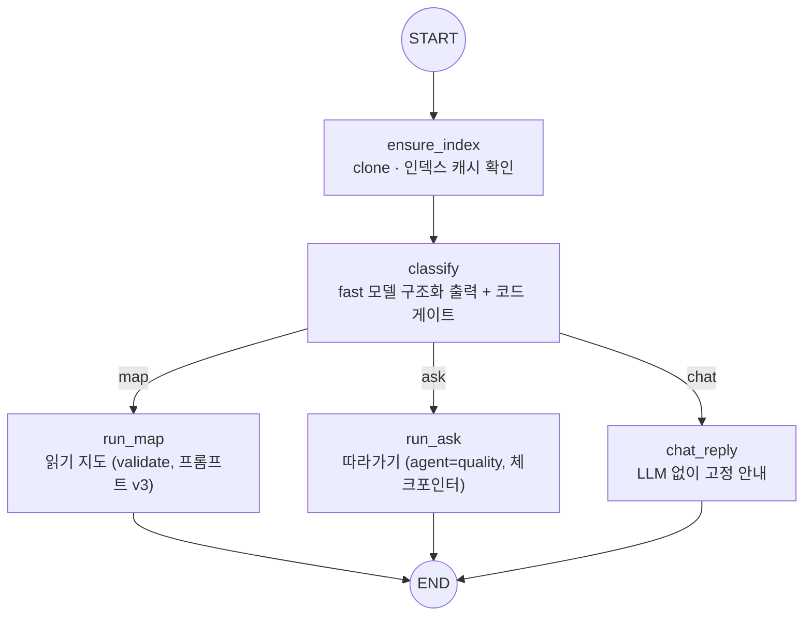
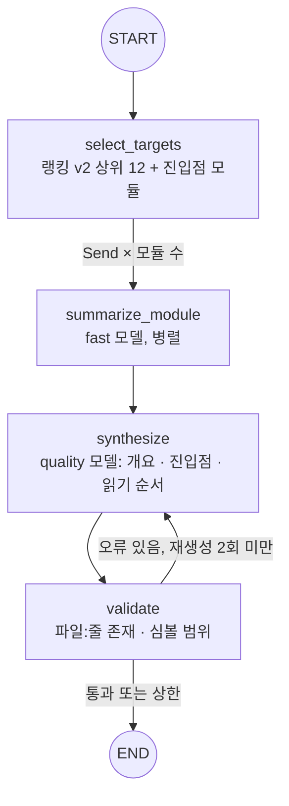
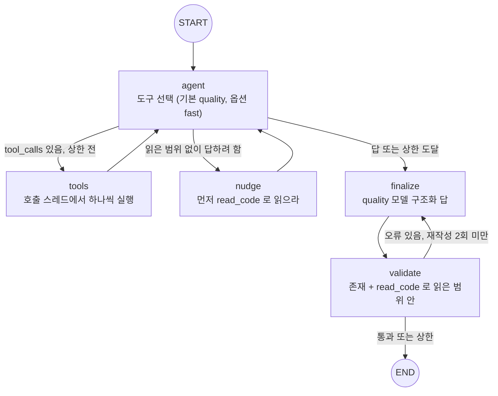

# Repoute 아키텍처

README 의 아키텍처 절을 자세히 적은 문서. 그래프 3개(Supervisor, 읽기 지도, 따라가기), 상태 스키마, 데이터 저장소, 비용 상한 장치, 설계 원칙 순서다. 코드 기준: `src/repoute/graphs/`, `src/repoute/api/`.

## 1. Supervisor 그래프 (`graphs/supervisor.py`)

API 와 프론트가 쓰는 단일 진입점. 메시지 하나를 받아 인덱스를 보장하고, 의도를 분류해 서브그래프 하나로 보낸다.

- **코드 게이트**: 모델이 `ask` 로 분류해도 메시지에 함수·클래스 이름이 하나도 없으면 `map` 으로 내린다. 따라가기 도구는 이름이 있어야 작동하기 때문이다. 게이트는 프롬프트가 아니라 정규식으로 둔다.
- **인덱스는 상태가 아니라 Deps 에**: SQLite 연결과 그래프는 직렬화가 안 되므로 `SupervisorDeps.indexes` 에 두고, 실행이 끝나면 닫는다.
- **진행 이벤트**: 노드마다 `events` 에 `IndexReady`, `IntentDecided`, `GateApplied`, `GuideReady`, `AnswerReady`, `Replied` 를 이어 붙인다. API 가 `stream_mode="updates"` 로 받아 SSE `update` 이벤트로 그대로 흘린다.

| 상태 필드 (`SupervisorState`) | 내용 |
|---|---|
| `repo_url`, `message`, `thread_id` | 입력 |
| `intent` | `Intent(kind: map/ask/chat, reason)` |
| `guide` / `answer` / `reply` | 의도별 결과 (`ReadingGuide` / `WalkthroughAnswer` / 고정 문구) |
| `validation_errors` | 서브그래프에 남은 인용 오류. 숨기지 않고 응답에 포함 |
| `events` | 진행 이벤트 목록 (`operator.add` 리듀서) |

## 2. 읽기 지도 서브그래프 (`graphs/reading_guide.py`)

- **입력이 품질을 정한다**: `select_targets` 는 역방향 개인화 PageRank(진입점 모듈이 시드, `__init__` 점수 ×0.2)로 모듈을 고른다. `synthesize` 에는 모듈 요약, 진입점 후보, 상위 import 관계 30개, 모듈별 "인용 가능한 줄" 목록이 들어간다. 심볼이 있는 파일의 목록에는 줄 1 을 넣지 않는다(troubleshooting 14).
- **병렬 노드에는 연결 대신 데이터**: `fan_out` 이 호출 스레드에서 심볼을 미리 읽어 `Send` 로 넘긴다. 병렬 노드는 DB 를 만지지 않는다(troubleshooting 04).
- **피드백은 "대신 쓸 줄"**: 검증 오류마다 "이 파일에서 인용 가능한 줄: …" 또는 "비슷한 경로" 힌트를 붙인다(troubleshooting 09).
- `validate=False`(CLI `--no-validate`)면 `synthesize → END`. 실험 E4 의 naive 모드다.

| 상태 필드 (`GuideState`) | 내용 |
|---|---|
| `targets` | 요약할 모듈 이름 |
| `summaries` | `ModuleSummary(module, file, summary, role)` 목록. `Send` 결과를 리듀서로 병합 |
| `guide` | `ReadingGuide(overview, entrypoints: list[CodeRef], reading_order: list[ReadingStep])` |
| `validation_errors`, `retry_count` | 검증 오류와 재생성 횟수 (피드백을 받고 다시 합성할 때만 증가) |

## 3. 따라가기 서브그래프 (`graphs/walkthrough.py`)

질문 하나로 호출 체인을 따라가는 ReAct 에이전트. 도구 5종: `find_definition`, `find_callers`, `find_callees`, `read_code`, `search_code`.

- **`tools` 노드를 직접 구현**: LangGraph `ToolNode` 는 도구를 스레드 풀에서 실행해 SQLite 연결이 깨진다(troubleshooting 15). 직접 구현한 덕에 상한·차단·인자 오류를 각각 ToolMessage 로 돌려줄 수 있다.
- **과정 강제는 도구 층에서**: 읽은 범위가 빈 채로 탐색만 6회 하면 `find_*` 를 실행하지 않고 "read_code 로 읽으라" 를 돌려준다. 이미 읽은 범위 안의 `read_code` 는 "이미 읽음" 을 돌려준다. 둘 다 예산을 소모한다(troubleshooting 20·21).
- **엄격 검증**: 인용이 실제로 존재해도 `read_code` 로 읽지 않은 줄이면 오류다. 읽지 않은 코드를 근거로 쓰지 못하게 한다.
- **상한 도달 처리**: 실행하지 못한 tool_call 마다 "실행 안 함: 도구 호출 상한" ToolMessage 를 붙여 대화 형식을 지키고, finalize 프롬프트 앞에 상한 안내를 넣는다(troubleshooting 16).
- **대화 이어 가기**: `SqliteSaver` 체크포인터, `thread_id` 기본값 `<repo_id>:default`.

| 상태 필드 (`WalkState`) | 내용 |
|---|---|
| `messages` | ReAct 대화 (`add_messages` 리듀서) |
| `tool_calls` | 도구 호출 누적 수 |
| `read_ranges` | `read_code` 로 실제 읽은 `(file, start, end)`. 체크포인트 복원 시 list 로 돌아옴(troubleshooting 17) |
| `answer` | `WalkthroughAnswer(question, steps: list[Step(order, title, explanation, refs)], summary)` |
| `validation_errors`, `retry_count` | 검증 오류와 재작성 횟수 |
| `nudges`, `explore_blocked` | 넛지 횟수, 탐색 상한으로 막힌 호출 수 (배치 지표) |

## 4. API (`api/app.py`)

| 엔드포인트 | 하는 일 | LLM |
|---|---|---|
| `GET /health` | 상태 확인 | 없음 |
| `POST /repos` | 인덱싱, 규모와 핵심 모듈 상위 5개 | 없음 |
| `GET /repos/{owner}/{name}/files` | 코드 뷰어용 파일 읽기. 레포 밖 경로 차단, 최대 200줄 | 없음 |
| `POST /threads/{thread_id}/runs` | Supervisor 실행. SSE 로 `update` · `result` · `error` · `done` | 있음 |
| `POST /feedback` | 👍/👎·인용 오류 신고를 LangSmith 실행(`run_id`)에 붙임 | 없음 |

- LLM 객체와 체크포인터는 lifespan 에서 한 번만 만든다. 요청마다 `SupervisorDeps` 를 새로 만들어 인덱스를 요청별로 둔다.
- 그래프는 별도 스레드에서 끝까지 돌고, 이벤트를 큐로 넘겨 async 스트림이 꺼낸다. SQLite 연결의 열기·쓰기·닫기가 모두 그 스레드에서 일어난다.

## 5. 데이터 저장소

| 저장소 | 위치 | 내용 | 키 · 수명 |
|---|---|---|---|
| clone 캐시 | `.repoute_cache/<owner>/<name>/` | shallow clone 한 소스 | 레포 단위. `read_code`·코드 뷰어가 읽는다 |
| 인덱스 (SQLite) | `.repoute_cache/index/<owner>__<name>@<commit7>.sqlite` | `symbols(name, kind, file, line_start, line_end)`, `calls(caller, callee, file, line)` | `repo@commit`. 같은 커밋은 다시 만들지 않음 |
| 인덱스 (그래프) | 같은 접두어 `.graph.json` | NetworkX import 그래프 | 마지막에 써서 "두 파일이 다 있음 = 인덱싱 완료" |
| 대화 | `.repoute_cache/threads.sqlite` | LangGraph `SqliteSaver` 체크포인트 | `thread_id`. 따라가기만 사용 |
| LangSmith | 프로젝트 `repoute-dev`(개발), `repoute-ci`(회귀 게이트) | 트레이스·토큰·비용, 데이터셋 2종, Experiment, Feedback | 테스트 중에는 트레이싱을 끈다(troubleshooting 05) |

`.repoute_cache/` 는 git 에 올리지 않고, 인덱싱 대상에서도 제외한다(troubleshooting 03).

## 6. 비용 상한 장치

| 장치 | 값 | 위치 | 목적 |
|---|---|---|---|
| 도구 호출 상한 | 15회 | `walkthrough.MAX_TOOL_CALLS` | ReAct 루프 종료 보장 |
| 인용 재작성·재생성 상한 | 2회 | `walkthrough.MAX_RETRIES`, `reading_guide.MAX_RETRIES` | 검증 루프 종료 보장 |
| 읽기 없는 탐색 상한 | 6회 | `walkthrough.MAX_EXPLORE_WITHOUT_READ` | 읽지 않고 탐색만 하다 예산 소진 방지. 거부도 예산 소모 |
| 넛지 | 1회 | `walkthrough.MAX_NUDGES` | 읽기 전 답 금지를 한 번만 되돌림 |
| 재읽기 차단 | 예산 1 소모 | `walkthrough.tools_node` | 같은 범위 반복 시 무한 루프 방지 |
| recursion limit | 44 = 1 + 2×15 + 2×1 + 2×3 + 5 | `walkthrough.RECURSION_LIMIT` | 프레임워크 기본값에 기대지 않고 최대 스텝을 명시 |
| 읽기 줄 수 | 1회 200줄 | `code_tools.MAX_READ_LINES` | 한 번에 들어가는 컨텍스트 제한 (API 코드 뷰어도 같음) |
| 요약 대상 · 입력 크기 | 모듈 12개(+진입점 모듈), 파일 앞 60줄, import 관계 30개 | `reading_guide.MAX_TARGETS` 등 | 읽기 지도 입력 토큰 제한 |
| 가벼운 경로 | `chat` 의도는 분류(fast) 1회 뒤 고정 안내, `index`·`/repos`·`/files` 는 LLM 없음 | Supervisor · API | 무거운 파이프라인이 필요 없는 요청의 과금 최소화 |
| CI 회귀 게이트 경로 필터 | `src/`·`evals/` 변경 PR 만 | `eval-regression.yml` | 문서만 바뀐 PR 에서는 과금 없음 |

과금 실행(실제 LLM 호출)은 자동으로 돌리지 않고, 예상 비용을 확인한 뒤 사람이 직접 실행한다(troubleshooting 07).

## 7. 설계 원칙

1. **정적 분석 우선, LLM 은 해석에만.** 구조·위치·호출 관계는 `ast` 와 그래프가 정하고, LLM 은 그것을 설명한다.
2. **`파일:줄` 인용 없는 코드 설명은 사용자에게 전달되지 않는다.** 검증에 실패한 인용은 숨기지 않고 실패로 표시한다.
3. **`repo@commit` 단위 인덱스 캐시.** 같은 커밋은 다시 인덱싱하지 않는다.
4. **사람이 코드를 쓴다.** 도구는 안내와 검토만 한다.
5. **측정 없는 개선 없음.** 베이스라인을 먼저 재고, 수치에는 n 과 방법을 적고, 측정하지 않은 수치는 쓰지 않는다.
6. **코드는 이해 가능한 크기로.** MVP 를 먼저 만들고 보완은 나중에 한다.
