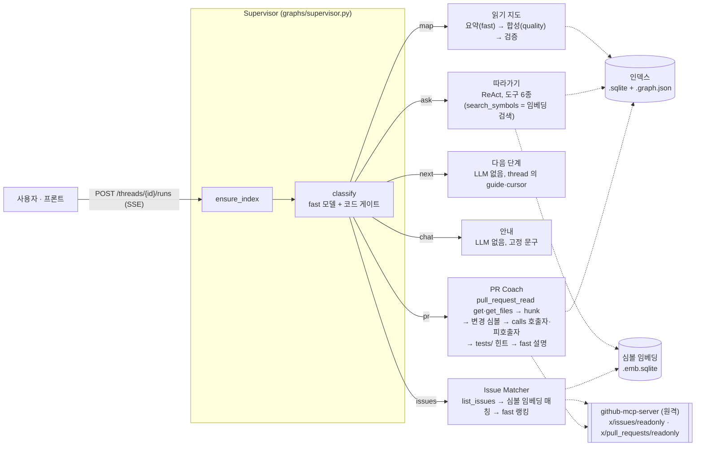
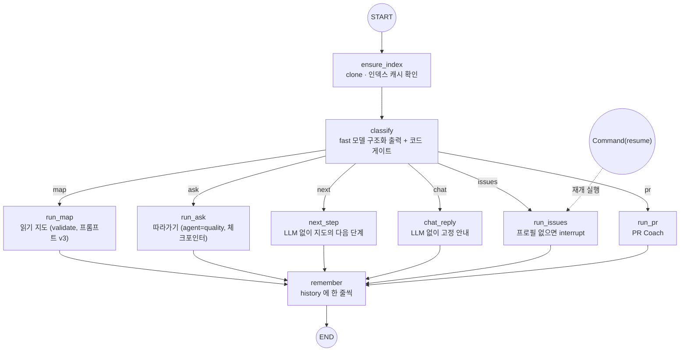
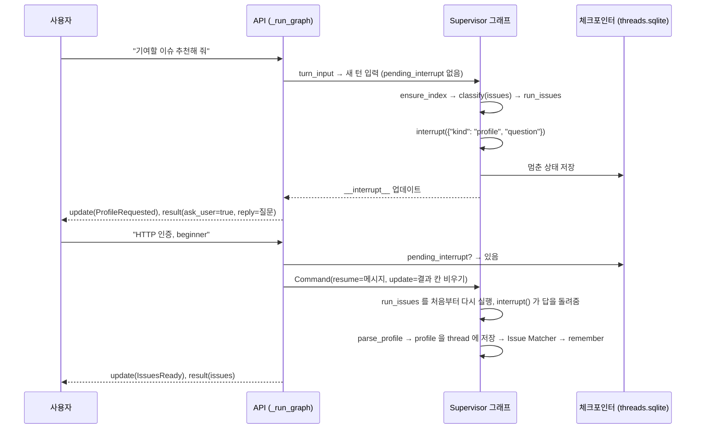
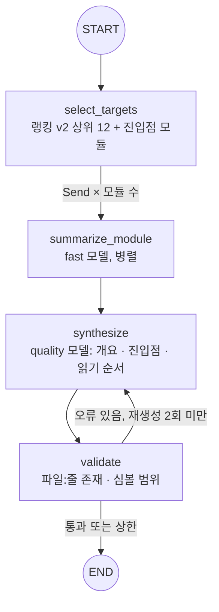
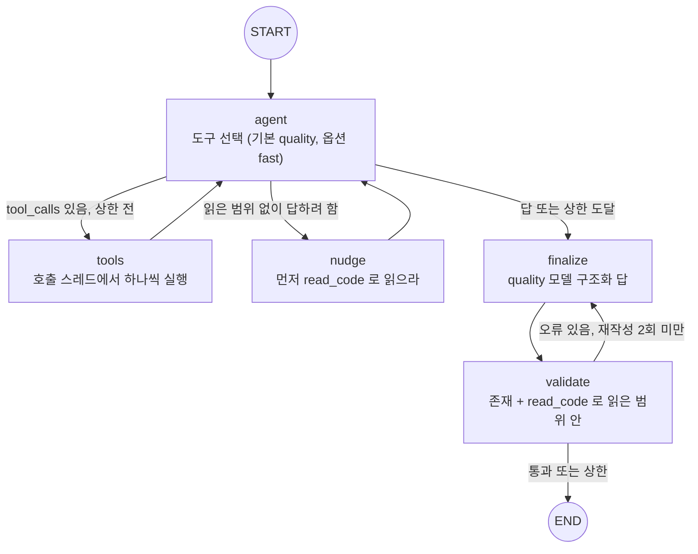
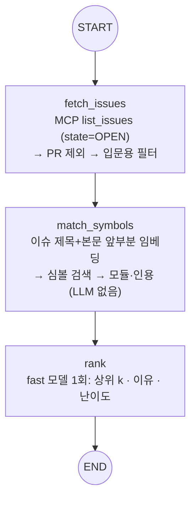
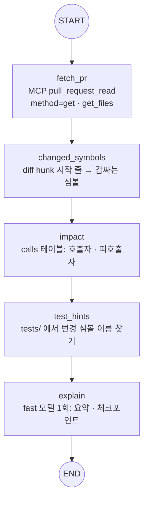

# Repoute 아키텍처

> 2026-10-21 Phase 7 기준. 이 문서는 구조만 다룬다. 측정 수치는 README 와 `evals/results/` 에 있다.

README 의 아키텍처 절을 자세히 적은 문서. 전체 그림, 그래프 5개(Supervisor, 읽기 지도, 따라가기, Issue Matcher, PR Coach), 정적 분석, API, GitHub MCP, 데이터 저장소, 비용 상한 장치, 설계 원칙 순서다. 코드 기준: `src/repoute/graphs/`, `src/repoute/indexing/`, `src/repoute/github/`, `src/repoute/api/`.

## 0. 전체 그림

메시지 하나가 들어오면 Supervisor 가 인덱스를 보장하고 의도 6종 중 하나로 보낸다. 구조·위치·호출 관계는 모두 정적 분석(인덱스·임베딩·파일 읽기)에서 나오고, LLM 은 그 결과를 설명만 한다.

| 의도 | 노드 | 서브그래프 / 처리 | LLM |
|---|---|---|---|
| `map` | `run_map` | 읽기 지도 (`graphs/reading_guide.py`) | fast(모듈 요약) + quality(합성) |
| `ask` | `run_ask` | 따라가기 (`graphs/walkthrough.py`) | quality(에이전트·답) |
| `next` | `next_step` | thread 에 남은 지도의 다음 단계 | 없음 |
| `chat` | `chat_reply` | 고정 안내 | 없음 |
| `issues` | `run_issues` | Issue Matcher (`graphs/issue_matcher.py`) | fast 1회 |
| `pr` | `run_pr` | PR Coach (`graphs/pr_coach.py`) | fast 1회 |

모든 의도는 그 앞에 분류(fast) 1회를 거친다. 예외는 interrupt 재개 실행으로, `classify` 를 건너뛰고 멈춘 노드부터 이어 간다(1절).

## 1. Supervisor 그래프 (`graphs/supervisor.py`)

API 와 프론트가 쓰는 단일 진입점. 메시지 하나를 받아 인덱스를 보장하고, 의도를 분류해 노드 하나로 보낸 뒤, 대화 기록을 남긴다.

### 의도별 노드

- **`run_map`**: 읽기 지도 서브그래프를 검증 루프를 켜고(프롬프트 v3) 돌린다. 새 지도는 `cursor=0` 으로 둔다.
- **`run_ask`**: 따라가기 서브그래프. `embedder` 가 있으면 먼저 `ensure_embeddings` 로 심볼 임베딩을 준비하고(`EmbeddingsReady`), 도구 `search_symbols` 가 붙는다(3절).
- **`next_step`**: 지도 카드는 전체 순서를 한 번에 보여 주므로, "다음" 은 그 단계를 하나씩 짚어 주는 기능이다. `cursor` 다음 단계의 파일·이유·인용·"따라가 줘" 힌트를 준다. "8번 다음"·"3단계까지 봤어" 처럼 본 단계 번호가 있으면(`SEEN_STEP_PATTERN`) `cursor` 를 그 번호로 옮긴 뒤 고른다. 마지막을 넘기면 고정 안내(`NEXT_DONE`).
- **`chat_reply`**: 고정 안내(`CHAT_REPLY`).
- **`run_issues`**: 토큰이 없으면 `ISSUES_NEED_TOKEN`, thread 가 없으면(재개할 곳이 없음) `ISSUES_NEED_THREAD` 안내만 준다. 프로필이 thread 에 없으면 interrupt 로 묻는다(아래). 그 뒤 GitHub MCP 도구를 처음 한 번만 불러(`_load_issue_tools`) Issue Matcher 를 돌린다(4절).
- **`run_pr`**: 토큰이 없으면 `PR_NEED_TOKEN`. `parse_pr_ref` 가 메시지에서 (레포 URL, PR 번호)를 뽑는다. PR URL 의 레포가 thread 레포와 같은 owner/name 이면 thread 의 URL 을 그대로 쓰고, 다르면 그 레포를 `build_index` 로 열어 `deps.indexes` 에 둔다. "PR #7"·"pull 7"·"풀리퀘 7" 은 thread 레포의 PR 이고, 의도가 이미 pr 일 때만 "#7" 도 받아 준다. 번호가 없으면 `PR_NEED_NUMBER`. 도구 로드(`_load_pr_tools`)와 리뷰는 확인을 모두 마친 뒤에 한다(5절).
- **`remember`**: 사용자 메시지와 도우미가 한 일 한 줄(`_agent_summary`)을 `history` 에 붙인다. 모든 경로가 END 전에 거친다.

### 코드 게이트

모델이 고른 의도를 정규식으로 바로잡는다. 게이트는 프롬프트가 아니라 코드에 둔다(wave06). 위에서부터 처음 맞는 규칙 하나만 쓰고, 결과가 모델의 의도와 다를 때만 `GateApplied` 이벤트를 남긴다.

| 순서 | 조건 | 바뀌는 의도 | 이유 |
|---|---|---|---|
| 1 | 메시지에 PR URL(`github.com/<o>/<r>/pull/<n>`) 이나 "PR #n"·"pull n"·"풀리퀘 n" (`PR_PATTERN`) | 무엇이든 → `pr` | URL 에는 "https" 같은 식별자가 있어 ask 로 남기 쉽고, "다음 PR #3" 처럼 "다음" 으로 시작해도 가리킨 것은 PR. 번호가 함께 있어야 걸린다 |
| 2 | "다음"·"그다음"·"이어서"·"next" 또는 "N번 다음/봤/읽었" 으로 시작 (`NEXT_PATTERN`) **그리고** thread 에 지도가 있음 | 무엇이든 → `next` | 지도를 다시 만들면 같은 1단계를 또 보여 주고 LLM 비용도 다시 든다 |
| 3 | 모델이 `next` 인데 thread 에 지도가 없음 | `next` → `map` | 이어 갈 읽기 순서가 없다 |
| 4 | 모델이 `ask` 인데 메시지에 함수·클래스 이름이 하나도 없음 (`SYMBOL_PATTERN`) **그리고** `search_symbols` 가 꺼짐 | `ask` → `map` | 이름 기반 도구(`find_definition` 등)는 이름이 있어야 작동한다. `embedder` 가 있으면 설명으로 출발점을 찾을 수 있어 이 규칙을 쓰지 않는다 |
| 5 | 모델이 `map`·`chat` 인데 "이슈·issue·기여·contribute·good first" 가 있음 (`ISSUE_PATTERN`) | `map`/`chat` → `issues` | 비용 0. `ask` 는 건드리지 않아 이름이 있는 질문의 따라가기는 잃지 않는다 |

- **분류 입력**: 프롬프트 `supervisor_v2.CLASSIFY` 에 최근 대화(`history` 의 최근 `HISTORY_IN_PROMPT` 개, 한 줄 `HISTORY_TEXT_LIMIT` 자까지)를 함께 넣는다.
- **인덱스는 상태가 아니라 Deps 에**: SQLite 연결과 그래프는 직렬화가 안 되므로 `SupervisorDeps.indexes` 에 두고, 실행이 끝나면 닫는다. 임베딩 저장소(`stores`)와 GitHub MCP 도구(`issue_tools`·`pr_tools`)도 Deps 에 둔다. 도구는 `None` 이면 첫 요청에서 한 번만 불러온다.

### interrupt 흐름 (프로필 질문)

이슈 추천은 프로필(관심 영역·수준)이 필요하다. thread 에 없으면 그래프를 멈추고 사용자에게 묻고, 같은 thread 의 다음 메시지를 답으로 받아 이어 간다.

- **`interrupt()` 는 노드를 예외로 멈춘다.** `Command(resume=답)` 으로 재개하면 `run_issues` 를 처음부터 다시 돌리고, 그때 `interrupt()` 가 답을 돌려준다. 그래서 interrupt 앞에는 다시 해도 되는 일(토큰·thread 확인)만 두고, 비용이 드는 일(도구 로드·매칭)은 뒤에 둔다.
- **재개 실행은 `ensure_index`·`classify` 를 거치지 않는다.** 인덱스가 없으면 `run_issues` 안에서 연다(캐시 히트). 분류 LLM 도 다시 부르지 않는다. API 는 재개 결과의 `intent` 를 `graph.get_state` 로 채운다.
- **`pending_interrupt(graph, config)`**: thread 의 `get_state(...).tasks` 에 실제 `interrupts` 가 걸려 있을 때만 그 값(`{"kind", "question"}`)을 돌려준다. `state.next` 만 보지 않는 이유: 노드가 예외로 끝난 실행도 `next` 가 남는다. 그 thread 에 새 메시지를 resume 으로 넘기면 실패한 노드를 그 메시지로 다시 돌리게 되므로, interrupt 가 걸린 경우만 재개하고 나머지는 새 턴으로 처음부터 실행한다. 체크포인터나 thread_id 가 없으면 항상 `None`.
- **`turn_input`**: 재개면 `Command(resume=message, update=_turn_reset())` 를, 아니면 새 턴 입력을 만든다. 재개 때도 결과 칸을 비워야 멈춘 실행의 events 가 재개 결과에 섞이지 않는다. 원래 `message`·`intent` 는 그대로 둔다(history 에는 이슈를 요청한 원래 말이 남는다).
- **질문 표시**: `ask_user_update` 가 그래프 출력의 `__interrupt__` 를 `reply=질문`, `ask_user=True`, `ProfileRequested` 이벤트로 바꾼다(알 수 없는 kind 는 `InputRequested`). 기존 프론트는 reply 를 그대로 보여 주므로 질문을 reply 에 넣는 것이 최소 변경이다.
- **`parse_profile`**: 쉼표로 나눈 조각에서 수준 단어(`beginner`·`초보`·`초급`·`입문`·`intermediate`·`중급`·`advanced`·`고급`)를 찾고 나머지는 관심 영역. 수준 단어가 없으면 beginner.
- **한계**: 질문을 받은 뒤 전혀 다른 말을 해도 그 말을 답으로 쓴다(프로필로 파싱된다).

### thread 와 체크포인트 네임스페이스

`build_supervisor_graph(deps, checkpointer)` 에 체크포인터를 주면 같은 `thread_id` 로 상태를 이어 간다(wave12). API 는 항상 체크포인터를 준다.

- **thread 에 남는 것**: `guide`(지도, `next` 가 쓴다), `cursor`(본 마지막 단계), `history`(최근 대화, `operator.add`), `profile`(이슈 추천 프로필, 다시 묻지 않는다). `intent`·`message` 도 남지만 매 턴 덮어쓴다.
- **매 턴 비우는 것** (`_turn_reset`): `answer`·`next`·`reply`·`issues`·`pr_review`·`validation_errors`, 그리고 `events`. events 리듀서 `add_events` 는 `None` 이 오면 비우고 리스트가 오면 이어 붙인다. `operator.add` 그대로면 events 가 실행마다 쌓이고, 리듀서를 없애면 노드마다 덮어써 한 실행 안의 이벤트를 잃기 때문이다.
- **따라가기 thread 는 따로**: 노드 안에서 따로 invoke 한 따라가기 그래프는 부모의 하위 그래프가 아니라 독립 루트로 체크포인트된다(네임스페이스 `""`). Supervisor 도 같은 체크포인터·thread_id 의 `""` 칸을 쓰므로 그대로 두면 두 상태가 섞여 따라가기 대화가 사라진다. 그래서 따라가기 thread 이름은 `{thread_id}:walkthrough` 다. thread_id 가 없으면 레포별 기본 `<repo_id>:default`(CLI 와 같은 규칙).
- 읽기 지도·Issue Matcher·PR Coach 서브그래프는 `compile(checkpointer=False)` 로 부모의 체크포인터를 물려받지 않는다. 한 번에 끝나는 그래프라 체크포인트가 필요 없다.

| 상태 필드 (`SupervisorState`) | 내용 |
|---|---|
| `repo_url`, `message`, `thread_id` | 입력 |
| `intent` | `Intent(kind: map/ask/next/chat/issues/pr, reason)` |
| `guide`, `cursor` | 읽기 지도(`ReadingGuide`)와 본 마지막 단계 번호(0 = 아직 없음). thread 에 남는다 |
| `answer` | 따라가기 결과 `WalkthroughAnswer` |
| `next` | 다음 단계 dict (`order`·`file`·`reason`·`ref`·`remaining`·`hint`) |
| `reply` | chat·안내·interrupt 질문 문구 |
| `profile` | 이슈 추천 프로필 (`Profile.model_dump()` dict). thread 에 남는다 |
| `issues` | Issue Matcher 결과 `IssueMatches` |
| `pr_review` | PR Coach 결과 `PRReview` |
| `validation_errors` | 서브그래프에 남은 인용 오류. 숨기지 않고 응답에 포함 |
| `history` | 최근 대화 `{"role": "user"/"agent", "text"}` (`operator.add`) |
| `events` | 이번 실행의 진행 이벤트 (`add_events` 리듀서) |

### 진행 이벤트

노드마다 `events` 에 이어 붙인다. API 가 `stream_mode="updates"` 로 받아 SSE `update` 이벤트로 그대로 흘린다.

| 이벤트 | 내는 곳 | 필드 |
|---|---|---|
| `IndexReady` | `ensure_index` | `repo_id`, `cached`, `files` |
| `IntentDecided` | `classify` | `kind`, `reason` (모델의 판단) |
| `GateApplied` | `classify` | `from`, `to`, `reason` (게이트가 바꿨을 때만) |
| `GuideReady` | `run_map` | `steps`, `errors` |
| `EmbeddingsReady` | `run_ask` (`embedder` 있을 때) | `count`, `cached` |
| `AnswerReady` | `run_ask` | `steps`, `errors` |
| `NextStep` | `next_step` | `order`(끝이면 `None`), `remaining` |
| `Replied` | `chat_reply`, `run_issues`·`run_pr` 의 안내 | 없음 |
| `ProfileRequested` | interrupt 표시 (`ask_user_update`) | `question` (알 수 없는 kind 면 `InputRequested`) |
| `IssuesReady` | `run_issues` | `count`, `considered` |
| `PRReviewReady` | `run_pr` | `number`, `changed`, `impact` |

## 2. 읽기 지도 서브그래프 (`graphs/reading_guide.py`)

- **입력이 품질을 정한다**: `select_targets` 는 역방향 개인화 PageRank(진입점 모듈이 시드, `__init__` 점수 ×0.2)로 모듈을 고른다. `synthesize` 에는 모듈 요약, 진입점 후보, 상위 import 관계 30개, 모듈별 "인용 가능한 줄" 목록이 들어간다. 심볼이 있는 파일의 목록에는 줄 1 을 넣지 않는다(troubleshooting 14).
- **병렬 노드에는 연결 대신 데이터**: `fan_out` 이 호출 스레드에서 심볼을 미리 읽어 `Send` 로 넘긴다. 병렬 노드는 DB 를 만지지 않는다(troubleshooting 04).
- **피드백은 "대신 쓸 줄"**: 검증 오류마다 "이 파일에서 인용 가능한 줄: …" 또는 "비슷한 경로" 힌트를 붙인다(troubleshooting 09).
- `validate=False`(CLI `--no-validate`)면 `synthesize → END`. 실험 E4 의 naive 모드다.

| 상태 필드 (`GuideState`) | 내용 |
|---|---|
| `targets` | 요약할 모듈 이름 |
| `summaries` | `ModuleSummary(module, file, summary, role)` 목록. `Send` 결과를 리듀서로 병합 |
| `guide` | `ReadingGuide(overview, entrypoints: list[CodeRef], reading_order: list[ReadingStep])` |
| `validation_errors`, `retry_count` | 검증 오류와 재생성 횟수 (피드백을 받고 다시 합성할 때만 증가) |

## 3. 따라가기 서브그래프 (`graphs/walkthrough.py`)

질문 하나로 호출 체인을 따라가는 ReAct 에이전트. 도구는 기본 5종 `find_definition`, `find_callers`, `find_callees`, `read_code`, `search_code` 에, 옵트인 6번째 `search_symbols` 가 붙는다(`tools/code_tools.py`).

| 도구 | 하는 일 | 근거 |
|---|---|---|
| `find_definition(name)` | 정의 위치. 결과 줄 끝에 `read_code(...)` 호출과 `인용: file:line` 힌트. 점 붙은 이름이 실패하면 `Class.method` → 끝 이름으로 다시 찾는다(troubleshooting 18) | `symbols` 테이블 |
| `find_callers(name)` | 이 이름을 부르는 곳 | `calls` 테이블 |
| `find_callees(symbol_name)` | 이 심볼 안의 호출 | `calls` 테이블 |
| `read_code(file, start, end)` | 줄 번호 붙은 실제 코드, 최대 200줄. 레포 밖 경로 차단 | 파일 |
| `search_code(query)` | 인덱스로 안 잡히는 문자열(대소문자 무시) | 파일 (`SKIP_DIRS` 제외) |
| `search_symbols(query)` *(옵트인)* | 이름을 모를 때 동작 설명으로 심볼 찾기. `kind name — file:start~end (유사도)` 와 `read_code(...)` 힌트 | 심볼 임베딩 (6절) |

- **`search_symbols` 는 옵트인**: `Deps` 에 `embedder` 와 `embedding_store` 가 둘 다 있을 때만 붙는다. 하나라도 없으면 도구 목록·차단 문구가 이전과 똑같다(before 측정과 같은 조건). API 는 켜고(lifespan 에서 `get_embedder`), CLI 는 `ask --search-symbols` 로 켠다. 켜지면 Supervisor 게이트 4(심볼 없는 ask → map)도 풀린다.
- **`tools` 노드를 직접 구현**: LangGraph `ToolNode` 는 도구를 스레드 풀에서 실행해 SQLite 연결이 깨진다(troubleshooting 15). 직접 구현한 덕에 상한·차단·인자 오류를 각각 ToolMessage 로 돌려줄 수 있다.
- **과정 강제는 도구 층에서**: 읽은 범위가 빈 채로 탐색만 6회 하면 `find_*` 를 실행하지 않고 "read_code 로 읽으라" 를 돌려준다. `search_symbols` 도 `read_code` 가 아니므로 탐색으로 센다(켜졌을 때의 차단 문구는 `EXPLORE_BLOCK_SEARCH`). 이미 읽은 범위 안의 `read_code` 는 "이미 읽음" 을 돌려준다. 둘 다 예산을 소모한다(troubleshooting 20·21).
- **엄격 검증**: 인용이 실제로 존재해도 `read_code` 로 읽지 않은 줄이면 오류다. 읽지 않은 코드를 근거로 쓰지 못하게 한다.
- **상한 도달 처리**: 실행하지 못한 tool_call 마다 "실행 안 함: 도구 호출 상한" ToolMessage 를 붙여 대화 형식을 지키고, finalize 프롬프트 앞에 상한 안내를 넣는다(troubleshooting 16).
- **대화 이어 가기**: `SqliteSaver` 체크포인터. thread 이름은 Supervisor 를 거치면 `{thread_id}:walkthrough`, thread 가 없거나 CLI 면 `<repo_id>:default`(1절).

| 상태 필드 (`WalkState`) | 내용 |
|---|---|
| `messages` | ReAct 대화 (`add_messages` 리듀서) |
| `tool_calls` | 도구 호출 누적 수 |
| `read_ranges` | `read_code` 로 실제 읽은 `(file, start, end)`. 체크포인트 복원 시 list 로 돌아옴(troubleshooting 17) |
| `answer` | `WalkthroughAnswer(question, steps: list[Step(order, title, explanation, refs)], summary)` |
| `validation_errors`, `retry_count` | 검증 오류와 재작성 횟수 |
| `nudges`, `explore_blocked` | 넛지 횟수, 탐색 상한으로 막힌 호출 수 (배치 지표) |

## 4. Issue Matcher 서브그래프 (`graphs/issue_matcher.py`)

프로필(관심 영역·수준)에 맞는 입문용 이슈를 고르고, 이슈마다 읽을 모듈과 코드 위치를 붙인다. RAG 2단계: 이슈 텍스트로 심볼 임베딩을 검색한다.

- **`fetch_issues`**: `call_tool_sync(list_issues, {owner, repo, state: "OPEN", perPage})` 로 열린 이슈를 받는다(8절). `parse_issues` 는 `pull_request` 키가 있는 항목(PR)을 빼고, GraphQL 응답에 없는 `labels`·`html_url` 은 빈 목록과 `https://github.com/{repo}/issues/{n}` 으로 채운다. `good_first_filter` 는 친화 라벨(`good first issue`·`help wanted`·`beginner`·`easy`)이 있거나, 라벨이 없으면 본문이 충분히 길고 댓글이 많지 않은 이슈만 남긴다.
- **`match_symbols`**: 후보 상위 `MAX_CANDIDATES` 개마다 `embedder.embed_query(제목 + 본문 앞부분)` → `store.search(k=SEARCH_K)`. 상위 결과로 `CodeRef(file, line_start, symbol)` 인용과, import 그래프 노드를 역조회한 모듈 이름을 붙인다. 임베딩 저장소가 없으면 모듈·인용 없이 순위만 매긴다. Supervisor 는 `embedder` 가 있으면 `ensure_embeddings` 로 저장소를 준비해 넘긴다.
- **`rank`**: fast 모델 1회, 구조화 출력 `Ranking(picks: [RankedPick(number, why, difficulty)])`. 입력은 이슈마다 번호·제목·라벨·본문 앞부분·매칭 모듈만. 후보가 없으면 LLM 을 부르지 않는다. 후보에 없는 번호나 같은 번호를 두 번 내면 버린다.
- **인용은 정적 결과만**: `RankedPick` 에는 인용 칸이 일부러 없다. `modules`·`refs` 는 `match_symbols` 의 검색 결과를 코드가 그대로 붙인다. 허용 범위는 지시가 아니라 입력/도구 층으로 강제해야 지켜진다.
- **LLM 호출 수**: 설계상 fast 1회(`rank`). 임베딩 쿼리는 후보 수만큼 따로 든다. Supervisor 경유면 그 앞에 분류 1회가 더해진다(재개 실행은 분류 없음).
- **실패 처리**: 도구가 없으면 `errors=["list_issues 도구가 없음"]`, 네트워크·인증·결과 형식 오류는 `"list_issues 실패 — 종류: 첫 줄"` 한 줄을 남기고 빈 후보로 끝낸다(그러면 `rank` 는 LLM 을 부르지 않는다). 예외를 그래프 밖으로 던지지 않는다.

| 상태 필드 (`IssueState`) | 내용 |
|---|---|
| `repo`, `profile`, `k` | 입력 ("owner/name", `Profile(interests, level)`, 추천 수) |
| `candidates` | 입문용 필터를 통과한 `Issue` 목록 |
| `matched` | 이슈 번호 → `{"modules": [...], "refs": [CodeRef, ...]}` |
| `matches` | `IssueMatch` 목록 |
| `errors` | 도구 호출 실패 (한 줄씩) |

결과 `IssueMatches(repo, profile, matches: list[IssueMatch(number, title, url, labels, why, modules, refs, difficulty)], considered, errors)`. `why`·`difficulty` 만 LLM 이 쓰고 나머지는 이슈·검색 결과다. `considered` 는 필터 뒤 후보 수.

## 5. PR Coach 서브그래프 (`graphs/pr_coach.py`)

PR 하나의 변경 심볼, 영향 범위, 관련 테스트, 리뷰어가 확인할 점을 인용과 함께 정리한다.

- **`fetch_pr`**: `pull_request_read` 를 `method="get"` 과 `method="get_files"` 로 두 번 부른다. get 결과가 JSON 이 아니면(서버가 오류 문장을 돌려준다) 그 문장을 잘라 errors 에 남기고 끝낸다. `parse_pull_request` 는 REST 모양(`filename`·`status`·`html_url`·`user.login`)과 GraphQL 모양(`path`·`changeType`·`url`·`author.login`)을 둘 다 읽는다. `parse_hunks` 는 `@@ -a,b +c,d @@` 를 새 파일 기준 `(c, c+d-1)` 로 바꾸고, 삭제만 있는 hunk 는 `(c, c)`, patch 가 없으면 빈 목록이다.
- **`changed_symbols`**: `.py` 파일만. hunk 시작 줄마다 `enclosing_symbol`(6절)로 가장 안쪽 심볼을 찾고 `(name, file)` 로 중복을 뺀다. 줄 번호는 PR 의 새 파일 기준, 심볼은 인덱스 커밋 기준이다. 인덱스 커밋에 없는 파일은 건너뛰고 `notes` 에 남긴다.
- **`impact`**: `calls` 테이블에서 이름 기준으로. 호출자는 callee 끝 이름이 변경 심볼 끝 이름인 호출의 caller 이고, 줄은 호출 줄이 아니라 호출자 정의 줄이다(코드 뷰어가 심볼 전체를 열 수 있게). 모듈 최상위 호출은 뺀다. 피호출자는 변경 심볼 안의 호출 중 정의를 하나로 정할 수 있을 때만 남긴다(같은 파일 우선, 아니면 레포에 하나뿐일 때). 같은 끝 이름이 여러 파일에 있으면 지어내지 않고 뺀다. 각각 `relation`(caller/callee)과 `via`(어느 변경 심볼 때문인지)를 단다.
- **`test_hints`** (함수 `suggest_tests`): 인덱스는 `SKIP_DIRS` 로 tests 를 빼므로 파일 시스템을 직접 훑는다. `tests/`·`test/` 아래이거나 `test_*.py`·`*_test.py` 인 파일에서 변경 심볼 끝 이름이 단어 단위로 등장하는 횟수가 많은 순. 함수 이름이 `test_` 로 시작하면 pytest 가 테스트로 모으므로 노드 이름과 함수 이름을 다르게 뒀다.
- **`explain`**: fast 모델 1회, 구조화 출력 `Explained(summary, check_points: [CheckText(text, symbol)])`. 입력은 PR 제목·본문 앞부분·변경 파일 목록·변경 심볼·영향·테스트 파일. PR 을 못 가져왔으면 빈 결과, 변경 심볼이 없으면 고정 문구(`NO_SYMBOL_SUMMARY`)를 주고 LLM 을 부르지 않는다.
- **인용은 정적 결과만**: `CheckText` 에는 인용 칸이 없고 심볼 이름만 있다. `attach_refs` 가 그 이름을 변경·영향 목록에서 찾아 `CodeRef` 를 붙인다(전체 이름이 같거나, 끝 이름이 같은 심볼이 하나뿐일 때). 목록에 없는 이름이면 `refs` 는 빈 목록이다. 변경 심볼·영향 범위·테스트 파일도 모두 정적 분석 결과다.
- **LLM 호출 수**: 설계상 fast 1회(`explain`). Supervisor 경유면 그 앞에 분류 1회.
- **실패 처리**: 도구가 없으면 `errors=["pull_request_read 도구가 없음"]`, 예외나 오류 문장은 `"pull_request_read 실패 — …"` 한 줄. `pr=None` 이면 뒤 노드는 빈 값으로 지나가고 LLM 도 부르지 않는다. 오류는 아니지만 알릴 것(인덱스 커밋에 없는 파일)은 `notes` 에 둔다.

| 상태 필드 (`PRState`) | 내용 |
|---|---|
| `repo`, `number` | 입력 ("owner/name", PR 번호) |
| `pr` | `PullRequest(number, title, body, url, author, merged_at, changed_files: list[ChangedFile])` 또는 `None` |
| `changed` | 변경 심볼 `SymbolRef(name, file, line)` |
| `impact` | `ImpactRef(name, file, line, relation, via)` |
| `test_files` | 테스트 힌트 파일 경로 |
| `summary`, `check_points` | LLM 요약과 `CheckPoint(text, refs)` |
| `errors`, `notes` | 도구 실패 한 줄씩 / 알릴 것 |

결과 `PRReview(repo, number, title, url, summary, changed_symbols, impact, test_files, check_points, errors, notes)`.

## 6. 정적 분석 (`indexing/`)

LLM 없이 구조·위치·호출 관계를 정한다. 모든 그래프와 API 는 이 결과만 인용한다.

### 인덱스 (`index.py`, `parser.py`, `symbols.py`, `imports.py`, `entrypoints.py`)

- `build_index(url)`: shallow clone → `ast` 파싱 → SQLite(`symbols`, `calls`) + NetworkX import 그래프. `SKIP_DIRS`(가상환경·빌드 산출물·`tests`·`docs`·`examples` 등)는 인덱싱하지 않는다. 같은 커밋의 두 파일이 다 있으면 다시 만들지 않는다.
- 진입점(`find_entrypoints`): `pyproject.toml` 의 `[project.scripts]`, 패키지 `__init__.py` 가 내보내는 이름, 경로·이름 감점으로 점수를 매긴다. 랭킹 v2(`rank_modules_v2`)는 진입점 모듈을 시드로 한 역방향 개인화 PageRank 다.

### 심볼 임베딩 (`embeddings.py`)

함수 이름이 없는 질문이나 이슈 텍스트에서 출발점 심볼을 찾는다. 파일 조각이 아니라 심볼(함수·메서드·클래스) 하나가 단위라, 결과가 곧 `kind name — file:줄` 이 되어 `read_code` 로 바로 이어진다.

- **`symbol_text`**: `"{kind} {name}\n{def 줄}\n{docstring}\n{file}"`. def 줄은 `SIGNATURE_LIMIT` 자, docstring 은 `DOCSTRING_LIMIT` 자까지(ast 없이 def 아래 따옴표 블록을 읽고 공백을 한 칸으로 줄인다). 본문 전체를 넣지 않아 비용이 심볼 수에 비례한다.
- **저장**: SQLite 파일 하나에 `embeddings(name, kind, file, line_start, line_end, model, vector BLOB)` 와 `meta(model, dim, count)`. 벡터를 다 받은 뒤 한 번에 쓰므로 중간에 API 가 실패하면 기존 파일은 그대로다. 연결을 들고 있지 않고 쓸 때마다 연다(API 요청 스레드가 바뀌어도 되게).
- **검색**: 전체 벡터를 한 번 메모리 행렬로 올려 행 길이 1로 정규화하고, 쿼리와의 내적(= 코사인 유사도) 상위 k 를 고른다(numpy, 동점이면 저장 순서). 벡터 DB·근사 검색(ANN) 없이 정확한 상위 k 를 얻는다.
- **캐시**: 경로는 인덱스와 같은 접두어 + `.emb.sqlite` 라 `repo@commit` 단위다. 같은 모델로 같은 건수가 이미 있으면 임베딩 API 를 부르지 않는다(`store.cached`). `ensure_embeddings` 가 준비를 맡고, 따라가기(`run_ask`)와 Issue Matcher 가 쓴다.
- 임베딩 모델은 `REPOUTE_EMBEDDING_MODEL`(기본 `openai:text-embedding-3-small`).

### 감싸는 심볼과 `/explain` (`explain.py`)

코드 뷰어에서 인용한 줄을 누르면 그 줄을 감싸는 심볼을 보여 주고, 원하면 설명을 붙인다.

- **`enclosing_symbol(db, root, file, line)`**: `symbols` 에서 그 줄을 포함하는 심볼 중 범위가 가장 짧은 것 = 가장 안쪽(메서드 > 클래스). docstring 은 파일을 `ast` 로 읽어 뽑는다. LLM 없음. `/symbol` 과 PR Coach `changed_symbols` 가 쓴다.
- **`explain_symbol`**: 심볼 코드를 줄 번호와 함께(최대 `MAX_READ_LINES` 줄) fast 모델 1회에 보내 `Explanation(what, watch, docstring_ko)` 를 받는다. `watch` 는 꼭 봐야 할 코드 몇 개로, 항목마다 `(줄 N)`·`(줄 N~M)` 참조를 단다. docstring 이 없는데 만든 번역은 버리고, 잘린 긴 심볼은 `what` 앞에 "앞 N줄 기준" 을 붙인다.
- **프롬프트 버전 캐시**: `.repoute_cache/index/explanations.sqlite` 의 키는 `(repo_id, file, line_start, prompt_version)`. 프롬프트 모듈(`explain_v2`)의 `VERSION` 이 바뀌면 옛 결과를 쓰지 않는다. 옛 스키마(버전 컬럼 없음)는 이름을 바꿔 새 테이블로 옮기며 `'v1'` 로 둔다.
- **`normalize_watch` 후처리 (결정론적, LLM 없음)**: (a) `(줄 N)` 만 있는 항목은 앞 항목 끝에 붙인다. (b) 범위 밖 줄 번호는 심볼 시작 줄의 천 단위를 더해 범위 안이 되면 고친다(앞자리를 잘라 쓰는 결함). (c) 그래도 범위 밖이면 지우지 않고 둔다(`watch_ref_issues` 로 센다). (d) 상한 개수를 넘으면 앞쪽만 남긴다. 멱등이라 캐시에서 읽은 옛 행에도 적용한다.

## 7. API (`api/app.py`)

| 엔드포인트 | 하는 일 | LLM |
|---|---|---|
| `GET /health` | 상태 확인 | 없음 |
| `POST /repos` | 인덱싱, 규모(파일·심볼·호출 수)와 핵심 모듈 상위 5개 | 없음 |
| `GET /repos/{owner}/{name}/files` | 코드 뷰어용 파일 읽기(`path`, `start`, `end`). 레포 밖 경로 차단, 최대 200줄, 역순 범위는 400 | 없음 |
| `GET /repos/{owner}/{name}/symbol` | `file`·`line` 을 감싸는 가장 안쪽 심볼 범위와 docstring. 없으면 404 | 없음 |
| `GET /repos/{owner}/{name}/explain` | 감싸는 심볼의 `what`·`watch`·`docstring_ko`, `cached`, `prompt_version`. LLM 오류는 502 | fast 1회 (캐시 히트면 없음) |
| `POST /threads/{thread_id}/runs` | Supervisor 실행(`repo_url`, `message`). SSE 로 `update` · `result` · `error` · `done`. thread 가 질문에서 멈춰 있으면 이 메시지가 답 | 있음 |
| `POST /feedback` | 👍/👎·인용 오류 신고를 LangSmith 실행(`run_id`)에 붙임 | 없음 |

`/symbol`·`/explain` 은 URL 을 몰라 `build_index` 를 부를 수 없으므로, `index/<owner>__<name>@*.sqlite` 중 가장 최근 파일을 열어 읽고 닫는다. 인덱스가 없으면 404.

### SSE

| 이벤트 | 데이터 |
|---|---|
| `update` | `{"node", "events"}`. 노드 하나가 끝날 때마다. interrupt 로 멈추면 `node="__interrupt__"`, events 에 `ProfileRequested` |
| `result` | 이번 실행의 최종 결과 (아래 필드) |
| `error` | `{"message"}` 한 줄 (잘못된 URL·git 실패·LLM 오류) |
| `done` | 끝 신호 |

| `result` 필드 | 내용 |
|---|---|
| `intent` | `{kind, reason}`. 재개 실행은 `classify` 를 거치지 않아 체크포인트에서 채운다 |
| `guide` | `ReadingGuide`. 이번 실행의 업데이트만 모으므로 map 일 때만 채워진다 |
| `answer` | `WalkthroughAnswer` (ask) |
| `next` | 다음 단계 dict (next) |
| `reply` | chat·안내 문구, 또는 `ask_user` 일 때 질문 |
| `issues` | `IssueMatches` (issues) |
| `pr_review` | `PRReview` (pr) |
| `ask_user` | true 면 `reply` 가 질문이고, 같은 thread 의 다음 메시지가 답 |
| `validation_errors` | 남은 인용 오류 |
| `thread_id`, `run_id` | thread, LangSmith 루트 실행 id(트레이싱이 꺼져 있으면 `null`) |

- LLM 객체, 임베딩 모델(`get_embedder`, 만들 때는 네트워크 호출 없음), 체크포인터(`threads.sqlite`), GitHub 토큰은 lifespan 에서 한 번만 만든다. 요청마다 `SupervisorDeps` 를 새로 만들어 인덱스를 요청별로 둔다.
- 첫 요청이 불러온 GitHub MCP 도구(`issue_tools`·`pr_tools`)는 요청이 끝나면 공용 deps 에 옮겨 두어 다음 요청이 다시 쓴다.
- 그래프는 별도 스레드에서 끝까지 돌고, 이벤트를 큐로 넘겨 async 스트림이 꺼낸다. SQLite 연결의 열기·쓰기·닫기가 모두 그 스레드에서 일어난다. 시작 입력은 `turn_input` 이 만들어, 멈춘 thread 면 `Command(resume)` 이 된다(1절).

## 8. GitHub MCP (`github/mcp.py`, `github/issues.py`, `github/prs.py`)

Issue Matcher 와 PR Coach 는 GitHub 데이터를 github-mcp-server 원격 엔드포인트에서 MCP 도구로 받는다.

- **엔드포인트**: 기본 URL `https://api.githubcopilot.com/mcp/`. toolset 을 주면 `x/<toolset>` 경로로 그 묶음만 받는다.

  | 용도 | URL | 남기는 도구 (`names`) |
  |---|---|---|
  | Issue Matcher | `https://api.githubcopilot.com/mcp/x/issues/readonly` | `ISSUE_TOOL_NAMES` = `list_issues`, `get_issue`, `search_issues` (그래프는 `list_issues` 만 부른다) |
  | PR Coach | `https://api.githubcopilot.com/mcp/x/pull_requests/readonly` | `PR_TOOL_NAMES` = `pull_request_read` (`method` 로 `get`·`get_files` 등을 나눈다) |
  | 측정용 전체 | `https://api.githubcopilot.com/mcp/` (toolset `None`) | 전부 (`get_all_tools`) |

- **연결**: `langchain_mcp_adapters` 의 `MultiServerMCPClient`, transport `streamable_http`, 헤더 `Authorization: Bearer <token>`. import 를 함수 안에 둬서 연결하지 않는 경로(테스트·dry-run)는 MCP 클라이언트를 읽지 않는다.
- **도구 필터**: `filter_tools(tools, names)` 로 필요한 이름만 남긴다. 전체 엔드포인트는 도구가 수십 개라, 에이전트에 바인딩하면 도구 설명이 매 LLM 호출의 입력 토큰이 된다. `tool_schema_tokens` 가 name + description + 인자 스키마 JSON 의 토큰 수를 잰다(tiktoken `o200k_base`, 없으면 글자 수 / 4). 지금의 두 그래프는 MCP 도구를 LLM 에 바인딩하지 않고, 노드 코드가 정해진 인자로 직접 부른다.
- **콘텐츠 블록 처리 (`_to_text`)**: github-mcp-server 는 결과를 MCP 콘텐츠 블록 목록 `[{"type": "text", "text": "..."}]` 으로 준다. 모든 블록이 text 면 text 들을 줄바꿈으로 이어 붙이고, 문자열이면 그대로, 그 밖은 JSON 문자열로 바꾼다. 파서(`parse_issues`, `parse_pull_request`)는 이 문자열을 JSON 으로 읽는다.
- **응답 모양 방어**: `list_issues` 는 GraphQL 응답이라 `labels`·`html_url` 이 없을 수 있고 댓글 수가 `{"totalCount": n}` 일 수 있다. PR 은 REST·GraphQL 모양을 둘 다 읽고, `{"pullRequest": {...}}`·`{"files": {"nodes": [...]}}` 같은 한 겹 포장을 벗긴다. REST 의 `url` 은 `api.github.com` 주소라 PR URL 로 쓰지 않는다.
- **비동기 도구의 동기 호출 (`call_tool_sync`)**: MCP 도구는 비동기 전용(`invoke` 는 `NotImplementedError`)인데 그래프 노드는 동기다. 실행 중인 이벤트 루프가 없으면(보통: API 는 그래프를 별도 스레드에서 돌린다) `asyncio.run(tool.ainvoke(args))`, 이미 루프 안이면 같은 스레드에서 `asyncio.run` 을 못 쓰므로 새 스레드에서 돌리고 기다린 뒤 예외는 호출한 스레드에서 다시 던진다. Supervisor 가 도구 목록을 불러올 때(`_run_async`)도 같은 패턴이다.
- **토큰**: 환경변수 `GITHUB_PERSONAL_ACCESS_TOKEN` → `Settings.github_token` → `SupervisorDeps.github_token`. 비어 있으면 `issues`·`pr` 의도는 MCP 를 부르지 않고 안내(reply)만 준다.
- **로드 시점**: 도구 목록은 프로세스에서 처음 issues·pr 요청이 올 때 한 번 불러오고(네트워크 호출) 이후 재사용한다. GitHub 결과 자체는 캐시하지 않는다.

## 9. 데이터 저장소

| 저장소 | 위치 | 내용 | 키 · 수명 |
|---|---|---|---|
| clone 캐시 | `.repoute_cache/<owner>/<name>/` | shallow clone 한 소스 | 레포 단위. `read_code`·코드 뷰어·테스트 힌트가 읽는다 |
| 인덱스 (SQLite) | `.repoute_cache/index/<owner>__<name>@<commit7>.sqlite` | `symbols(name, kind, file, line_start, line_end)`, `calls(caller, callee, file, line)` | `repo@commit`. 같은 커밋은 다시 만들지 않음 |
| 인덱스 (그래프) | 같은 접두어 `.graph.json` | NetworkX import 그래프 | 마지막에 써서 "두 파일이 다 있음 = 인덱싱 완료" |
| 심볼 임베딩 | 같은 접두어 `.emb.sqlite` | `embeddings(name, kind, file, line_start, line_end, model, vector)`, `meta(model, dim, count)` | `repo@commit`. 같은 모델·같은 건수면 다시 만들지 않음 |
| 심볼 설명 | `.repoute_cache/index/explanations.sqlite` | `explanations(repo_id, file, line_start, what, watch_json, docstring_ko, prompt_version)` | `(repo_id, file, line_start, prompt_version)` |
| 대화 | `.repoute_cache/threads.sqlite` | LangGraph `SqliteSaver` 체크포인트 | Supervisor 는 `thread_id`, 따라가기는 `{thread_id}:walkthrough`(CLI 는 `<repo_id>:default`). 되살릴 pydantic 타입은 `memory/checkpointer.py` 의 `CHECKPOINT_TYPES` 에 등록 |
| LangSmith | 프로젝트 `repoute-dev`(개발), `repoute-ci`(회귀 게이트) | 트레이스·토큰·비용, 데이터셋 2종, Experiment, Feedback | 테스트 중에는 트레이싱을 끈다(troubleshooting 05) |

`.repoute_cache/` 는 git 에 올리지 않고, 인덱싱 대상에서도 제외한다(troubleshooting 03). 체크포인터는 `check_same_thread=False` 로 연다(LangGraph 가 다른 스레드에서 쓸 수 있고, `SqliteSaver` 가 내부 락으로 직렬화한다). 상태에 새 pydantic 클래스를 넣으면 `CHECKPOINT_TYPES` 에 더한다.

## 10. 비용 상한 장치

| 장치 | 값 | 위치 | 목적 |
|---|---|---|---|
| 도구 호출 상한 | 15회 | `walkthrough.MAX_TOOL_CALLS` | ReAct 루프 종료 보장 |
| 인용 재작성·재생성 상한 | 2회 | `walkthrough.MAX_RETRIES`, `reading_guide.MAX_RETRIES` | 검증 루프 종료 보장 |
| 읽기 없는 탐색 상한 | 6회 | `walkthrough.MAX_EXPLORE_WITHOUT_READ` | 읽지 않고 탐색만 하다 예산 소진 방지. 거부도 예산 소모. `search_symbols` 도 탐색으로 셈 |
| 넛지 | 1회 | `walkthrough.MAX_NUDGES` | 읽기 전 답 금지를 한 번만 되돌림 |
| 재읽기 차단 | 예산 1 소모 | `walkthrough.tools_node` | 같은 범위 반복 시 무한 루프 방지 |
| recursion limit | 44 = 1 + 2×15 + 2×1 + 2×3 + 5 | `walkthrough.RECURSION_LIMIT` | 프레임워크 기본값에 기대지 않고 최대 스텝을 명시 |
| 읽기 줄 수 | 1회 200줄 | `code_tools.MAX_READ_LINES` | 한 번에 들어가는 컨텍스트 제한 (API 코드 뷰어·`/explain` 입력도 같음) |
| 요약 대상 · 입력 크기 | 모듈 12개(+진입점 모듈), 파일 앞 60줄, import 관계 30개 | `reading_guide.MAX_TARGETS` 등 | 읽기 지도 입력 토큰 제한 |
| 분류 문맥 | 최근 대화 4개, 한 줄 200자 | `supervisor.HISTORY_IN_PROMPT`, `HISTORY_TEXT_LIMIT` | 대화가 길어져도 분류 프롬프트 크기 고정 |
| 심볼 검색 결과 | 5개 | `code_tools.MAX_SYMBOL_HITS` | `search_symbols` 결과 토큰 제한 |
| 임베딩 캐시 | 같은 모델·같은 건수면 API 없음 | `SymbolEmbeddingStore.build` | 유료 임베딩 호출은 레포·커밋당 1회 |
| 설명 캐시 | 같은 심볼·같은 프롬프트 버전이면 LLM 없음 | `explain.explain_symbol` | `/explain` 반복 호출 비용 0 |
| Issue Matcher 입력 | 이슈 30개 수집, 후보 10개(임베딩 쿼리도 이만큼), 이슈마다 심볼 5개·모듈 3개·인용 3개, 본문 300자 | `issue_matcher.PER_PAGE`, `MAX_CANDIDATES`, `SEARCH_K` 등 | 랭킹 LLM 1회의 입력 크기 제한 |
| PR Coach 입력 | 변경 심볼 20개, 심볼마다 호출자 5·피호출자 3, 영향 전체 30, 테스트 파일 5(훑기 500개), 체크포인트 5, 본문 500자 | `pr_coach.MAX_CHANGED` 등 | 설명 LLM 1회의 입력 크기와 테스트 스캔 시간 제한 |
| LLM 생략 경로 | 후보 이슈 없음, PR 못 가져옴, 변경 심볼 없음 | `issue_matcher.rank`, `pr_coach.explain` | 설명할 정적 결과가 없으면 LLM 을 부르지 않음 |
| MCP 도구 범위 | 읽기 전용 toolset + 이름 필터 | `github.mcp` | 필요한 도구만 로드 (8절) |
| 가벼운 경로 | `chat`·`next` 의도는 분류(fast) 1회 뒤 LLM 없음, 토큰·PR 번호 없는 `issues`·`pr` 은 안내만, `index`·`/repos`·`/files`·`/symbol` 은 LLM 없음 | Supervisor · API | 무거운 파이프라인이 필요 없는 요청의 과금 최소화 |
| CI 회귀 게이트 경로 필터 | `src/`·`evals/` 변경 PR 만 | `eval-regression.yml` | 문서만 바뀐 PR 에서는 과금 없음 |

과금 실행(실제 LLM 호출)은 자동으로 돌리지 않고, 예상 비용을 확인한 뒤 사람이 직접 실행한다(troubleshooting 07).

## 11. 설계 원칙

1. **정적 분석 우선, LLM 은 해석에만.** 구조·위치·호출 관계는 `ast` 와 그래프가 정하고, LLM 은 그것을 설명한다.
2. **`파일:줄` 인용 없는 코드 설명은 사용자에게 전달되지 않는다.** 검증에 실패한 인용은 숨기지 않고 실패로 표시한다.
3. **`repo@commit` 단위 인덱스 캐시.** 같은 커밋은 다시 인덱싱하지 않는다.
4. **사람이 코드를 쓴다.** 도구는 안내와 검토만 한다.
5. **측정 없는 개선 없음.** 베이스라인을 먼저 재고, 수치에는 n 과 방법을 적고, 측정하지 않은 수치는 쓰지 않는다.
6. **코드는 이해 가능한 크기로.** MVP 를 먼저 만들고 보완은 나중에 한다.
