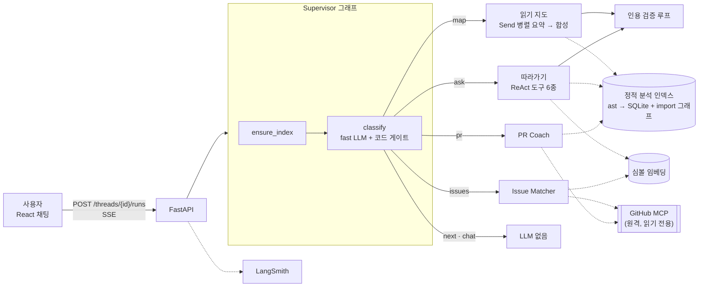
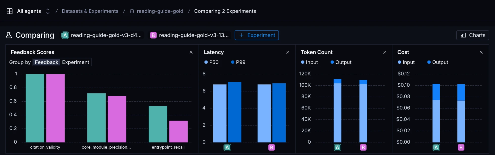
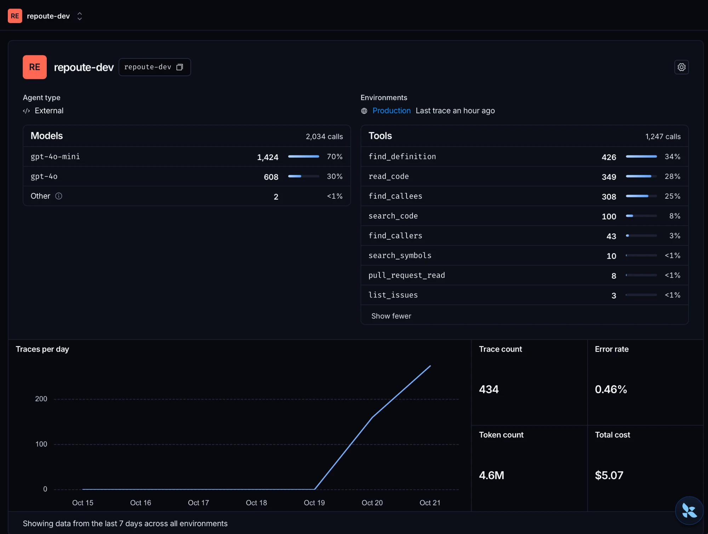

# AI Mini Project : Repoute 최종 보고서

> GitHub URL 하나로 *어디서부터 읽을지*, *코드가 어떻게 흐르는지*, *어떤 이슈·PR 부터 보면 좋을지*를 `파일:줄` 근거와 함께 안내하는, 오픈소스 기여를 처음 시작하는 개발자를 위한 AI Agent.

| 항목 | 내용 |
|---|---|
| 기준일 | 2026-10-22 (v2, Phase 7) |
| 지원 범위 | Python 레포 |
| 스택 | LangGraph · LangChain · LangSmith · FastAPI(SSE) · Vite/React · GitHub MCP |
| 동작 확인 | `repoute index psf/requests` 0.83s (파일 20 · 심볼 320 · 호출 988) |

**목차**
1. [핵심 기능](#1-핵심-기능)
2. [아키텍처](#2-아키텍처)
3. [핵심 기술](#3-핵심-기술) — Multi-agent · MCP · RAG · 의존성 주입 · 모듈화 · 단위 테스트
4. [Before / After 수치](#4-before--after-수치)
5. [LangSmith 활용](#5-langsmith-활용)
6. [한계 · 트레이드오프 · 개선 방향](#6-한계--트레이드오프--개선-방향)

---

## 1. 핵심 기능

| 기능 | 한 줄 설명 |
|---|---|
| **읽기 지도** | 진입점과 추천 읽기 순서. 핵심 모듈은 import 그래프 랭킹으로 고른다 |
| **따라가기** | 질문 하나로 호출 체인을 따라가며 **실제로 읽은 코드만** 근거로 든다. 함수 이름을 몰라도 동작 설명으로 찾는다 |
| **다음 단계** | "다음", "3단계까지 봤어" 로 지도를 한 단계씩 짚는다 (LLM 없음, 비용 0) |
| **Issue Matcher** | 관심 영역·수준에 맞는 열린 이슈와 읽을 코드 위치. 프로필이 없으면 멈추고 묻는다 |
| **PR Coach** | PR 의 변경 심볼 → 호출자(영향 범위) → 관련 테스트 → 리뷰 체크포인트 |
| **코드 뷰어 · 설명 패널** | 답에 붙은 근거 위치(`파일:줄`)를 누르면 그 코드와 한국어 요약을 보여 준다 |

**레포 불러오기 → 읽기 지도 → 근거 위치(`파일:줄`)를 눌러 코드와 설명 보기**


**함수 이름을 몰라도 동작 설명만으로 질문 — "세션 쿠키와 요청 쿠키는 어디서 합쳐져?" → `merge_cookies` 까지 찾아감**


| 읽기 지도 | 따라가기 |
|---|---|
|  |  |
| 진입점 + 읽기 순서 · 평균 **7.6s · $0.022** (레포 5개)<br/> | `requests.get()` → `Session.send` → `HTTPAdapter` · 평균 **14.4s** (질문 20개)<br/> |
| **Issue Matcher** | **PR Coach** |
|  |  |
| 프로필 질문(interrupt) 후 추천 · **$0.0003** | PR #6767 변경 → 호출자 → 체크포인트 · **$0.0004** |

---

## 2. 아키텍처




### 설계 원칙 4가지

| 원칙 | 의미 |
|---|---|
| **근거는 정적 분석, LLM 은 설명** | 함수 위치·호출 관계·import 는 `ast` 로 뽑아 SQLite·NetworkX 에 둔다. LLM 은 이 데이터를 설명만 한다 |
| **규칙은 프롬프트가 아니라 코드에** | 의도 분류 보정, 인용 검증, 탐색 상한 모두 코드로 강제한다 |
| **LLM 없는 경로를 만든다** | `next`·`chat`·코드 뷰어는 LLM 을 부르지 않는다. 인덱스·임베딩은 `repo@commit` 단위로 캐시 |
| **오류는 숨기지 않는다** | 검증 후에도 남은 인용 오류는 화면에 표시한다 |

### 핵심 코드 — Supervisor 그래프

[`src/repoute/graphs/supervisor.py`](../src/repoute/graphs/supervisor.py#L547)

```python
def build_supervisor_graph(deps, checkpointer=None):
    builder = StateGraph(SupervisorState)
    # ... 노드 등록 ...
    builder.add_edge(START, "ensure_index")                              # ① 인덱스 준비
    builder.add_edge("ensure_index", "classify")                         # ② 의도 분류
    builder.add_conditional_edges("classify", route, list(ROUTES.values()))  # ③ 6갈래 분기
    for node in ROUTES.values():
        builder.add_edge(node, "remember")                               # ④ 대화 기억
    builder.add_edge("remember", END)
    return builder.compile(checkpointer=checkpointer)                    # thread 상태 저장
```

### 핵심 코드 — LLM 판단을 코드로 보정 (코드 게이트)

[`supervisor.py` `_gate`](../src/repoute/graphs/supervisor.py#L175) — 위에서부터 처음 맞는 규칙 하나만 적용, 비용 0

```python
if PR_PATTERN.search(message):                       # PR URL·"PR #7" → 무조건 pr
    return "pr", "..."
if NEXT_PATTERN.match(message) and has_guide:        # "다음..." + 지도 있음 → next (LLM 재호출 방지)
    return "next", "..."
if kind == "next" and not has_guide:                 # 지도 없는 next → map
    return "map", "..."
if kind == "ask" and not can_search and not SYMBOL_PATTERN.search(message):
    return "map", "..."                              # 함수 이름 없는 질문 + 검색 도구 없음 → map
if kind in ("map", "chat") and ISSUE_PATTERN.search(message):
    return "issues", "..."
```

---

## 3. 핵심 기술

### 3-1. Multi-agent — Supervisor 패턴

자율 에이전트끼리 협상하는 구조가 아니라 **라우터 + 서브그래프 4개 + `Send` 병렬 + `interrupt`** 로 구성했다. 기능마다 필요한 만큼만 LLM 을 쓴다.

| 에이전트 | 패턴 | LLM |
|---|---|---|
| Supervisor | 의도 분류 → 라우팅 | fast 1회 |
| 읽기 지도 | **`Send` 팬아웃** — 모듈 수만큼 요약을 병렬 실행 후 합성 | fast × N + quality 1회 |
| 따라가기 | **ReAct** — 도구 반복 호출 (상한 15회) | quality |
| Issue Matcher | MCP → 임베딩 매칭 → 랭킹 | fast 1회 |
| PR Coach | MCP → 정적 분석 4단계 → 설명 | fast 1회 |

**`Send` 병렬** — [`reading_guide.py` `fan_out`](../src/repoute/graphs/reading_guide.py#L95)

```python
def fan_out(state, deps) -> list[Send]:
    """모듈마다 summarize_module 을 하나씩 병렬 실행"""
    return [Send("summarize_module", {"module": m, "symbols": ...}) for m in state["targets"]]
```

**Human-in-the-loop (`interrupt`)** — [`supervisor.py` `run_issues`](../src/repoute/graphs/supervisor.py#L393)

```python
if state.get("profile") is None:
    answer = interrupt({"kind": "profile", "question": PROFILE_QUESTION})  # 그래프를 멈추고 질문
    profile = parse_profile(str(answer))                                 # 재개되면 답을 받음
# ↓ 비용이 드는 일(MCP 도구 로드·매칭)은 interrupt 뒤에 둔다 — 재개 시 노드가 처음부터 다시 돌기 때문
```


> Turn 5 는 `run_issues` 에서 0.01s 만에 멈추고, Turn 6 은 `Command(resume="HTTP 쿠키, beginner")` 로 분류 없이 바로 이어 간다.

### 3-2. MCP — GitHub 원격 MCP 서버

- GitHub 공식 **원격** github-mcp-server 에 `langchain-mcp-adapters` 로 연결한다 (설치 불필요).
- **LLM 에 도구를 바인딩하지 않고 노드가 직접** 정해진 인자로 1~2회 호출한다 → 호출 횟수·비용이 예측 가능.
- **읽기 전용 toolset + 이름 필터**로 도구 설명 토큰을 **12.8k → 1.2k (−91%)**.

[`src/repoute/github/mcp.py`](../src/repoute/github/mcp.py#L24)

```python
GITHUB_MCP_URL = "https://api.githubcopilot.com/mcp/"
ISSUE_TOOL_NAMES = ("list_issues", "get_issue", "search_issues")   # 필요한 3개만

def github_connection(token, toolset="issues/readonly"):
    url = GITHUB_MCP_URL + f"x/{toolset}"          # ① 읽기 전용 도구 묶음만 받기
    return {"transport": "streamable_http", "url": url,
            "headers": {"Authorization": f"Bearer {token}"}}

async def load_github_tools(token, toolset="issues/readonly", names=None):
    return filter_tools(await get_all_tools(token, toolset), names or ISSUE_TOOL_NAMES)  # ② 이름 필터
```

노드에서 직접 호출 — [`issue_matcher.py` `fetch_issues`](../src/repoute/graphs/issue_matcher.py#L106)

```python
tool = deps.issue_tools.get("list_issues")
args = {"owner": owner, "repo": name, "state": ISSUE_STATE, "perPage": PER_PAGE}
issues = parse_issues(call_tool_sync(tool, args), repo=state["repo"])
```


> PR Coach 트레이스: `pull_request_read` 2회(get · get_files)를 노드가 직접 부르고, LLM 은 마지막 `explain` 1회뿐이다.

### 3-3. RAG — 심볼 임베딩 검색

문서 조각이 아니라 **함수·클래스(심볼) 단위**로 임베딩한다. 검색 결과로 `파일:줄` 범위를 돌려주고, 에이전트가 그 범위를 `read_code` 로 **실제로 읽어야만** 인용할 수 있다.

| 구성 | 선택 | 이유 |
|---|---|---|
| 임베딩 | `text-embedding-3-small` | 레포당 1회 ≤ $0.005, 이후 커밋 단위 캐시 |
| 저장 | SQLite (`.emb.sqlite`) | 레포 하나 심볼 수천 개 → 벡터 DB 불필요 |
| 검색 | numpy 행렬 곱 1회 (코사인) | 수 ms, 근사 없이 정확한 top-k |

[`embeddings.py` `search`](../src/repoute/indexing/embeddings.py#L185) · [`code_tools.py` `search_symbols`](../src/repoute/tools/code_tools.py#L122)

```python
# 검색: 전체 심볼과 코사인 유사도를 한 번에
scores = matrix @ (query / np.linalg.norm(query))
top = np.argsort(-scores)[:k]

# LLM 이 부르는 도구: 이름을 몰라도 설명으로 출발점을 찾는다
@tool
def search_symbols(query: str) -> str:
    """함수·클래스 이름을 모를 때 동작을 설명하는 말로 찾는다(예: "리디렉트 횟수 초과 예외")."""
    for h in store.search(embedder.embed_query(query), k=MAX_SYMBOL_HITS):
        ...  # → "function merge_cookies — src/requests/cookies.py:604~625 → read_code(...)"
```

같은 임베딩을 **Issue Matcher** 에서도 쓴다: 이슈 제목+본문 → 관련 심볼 검색 → 읽을 모듈 추천 (p@3 0.85).

### 3-4. 의존성 주입 (DI)

LLM·인덱스·임베딩·MCP 도구를 **노드 안에서 만들지 않고 `Deps` 로 주입**한다. 그래서 테스트에서는 가짜, 실서버에서는 진짜를 주입한다.

[`graphs/deps.py`](../src/repoute/graphs/deps.py) · [`api/app.py` `lifespan`](../src/repoute/api/app.py#L166)

```python
@dataclass
class Deps:
    """그래프 노드가 쓰는 의존성 묶음. 테스트에서는 가짜 LLM 을 꽂는다."""
    fast_llm: Any            # 저비용 모델 (분류·요약)
    quality_llm: Any         # 고품질 모델 (합성·따라가기)
    index: RepoIndex         # 정적 분석 결과
    embedder: Any = None     # 옵트인: 있으면 search_symbols 도구가 붙는다
    embedding_store: Any = None

# 노드에 주입: LangGraph 는 state 만 넘기므로 partial 로 deps 를 미리 채운다
builder.add_node("classify", partial(classify, deps=deps))

# API: 서버 시작 시 1회만 진짜 객체 생성, 테스트는 create_app(deps=가짜) 로 대체
def create_app(deps=None, feedback_client=None): ...
```

- **SQLite 연결·그래프는 직렬화가 안 돼서** 상태(state)가 아니라 Deps 에 둔다.
- MCP 도구는 `None` 이면 **첫 요청에서 한 번만** 불러온다 (지연 로드).

### 3-5. 모듈화

```
src/repoute/
├── graphs/       # 에이전트 그래프 5개 (supervisor + 서브그래프 4개)
├── indexing/     # 정적 분석 — ast 파싱 · SQLite · import 그래프 · 임베딩 (LLM 없음)
├── tools/        # 따라가기 도구 6종
├── validation/   # 파일:줄 인용 검증 (LLM 없음)
├── github/       # MCP 연결 · 이슈·PR 파싱
├── prompts/      # 버전별 프롬프트 (v1 · v2 · v3)
├── memory/       # SqliteSaver 체크포인터
└── api/          # FastAPI + SSE
```

- **LLM 을 쓰는 층(graphs)과 안 쓰는 층(indexing·validation)을 분리** → 정적 부분은 결정론적으로 테스트·평가 가능.
- **프롬프트를 모듈로 버전 관리**하고 인자로 주입한다: `run_reading_guide(sub, prompts=reading_guide_v3)` → A/B 실험과 회귀 비교가 쉽다.
- 서브그래프는 단독 실행도 된다 (CLI `repoute map / ask / issues / pr`).

### 3-6. 단위 테스트

| 항목 | 내용 |
|---|---|
| 규모 | 테스트 파일 37개 통과 (11.3s) |
| 원칙 | **실제 LLM·임베딩·MCP 호출 0** — 과금 없음 |
| 가짜 객체 | `FakeLLM`(구조화 출력 큐), `FakeEmbedder`(해시 기반 결정론 벡터), `FakeListIssues`(MCP 도구), `FakeFeedbackClient` |
| 실데이터 픽스처 | 실제 MCP 서버 응답을 저장해 테스트에 사용 (실서버 응답 모양까지 검증) |
| CI | `ci.yml`(ruff + pytest) + `eval-regression.yml`(지표 회귀 게이트) |

[`tests/test_supervisor.py`](../tests/test_supervisor.py#L165) — DI 덕분에 그래프 전체를 가짜 LLM 으로 검증한다

```python
def test_gate_demotes_ask_without_symbol(tmp_path, repo_url):
    """LLM 이 ask 라 해도 메시지에 식별자가 없으면 코드 게이트가 map 으로 내린다."""
    deps = _deps(tmp_path, [Intent(kind="ask", reason="흐름 질문")], quality)  # 가짜 LLM 주입
    state = run_supervisor(deps, repo_url, "코드 흐름 알려줘")
    assert state["intent"].kind == "map"
    assert _types(state) == ["IndexReady", "IntentDecided", "GateApplied", "GuideReady"]
```

---

## 4. Before / After 수치

> 모든 수치는 `evals/results/` 의 측정 기록이다. (LLM-as-judge 미사용)

| 지표 | Before → After | n | 무엇을 바꿨나 |
|---|---|---|---|
| 읽기 지도 핵심 모듈 precision@5 | 0.32 → **0.72** | 레포 5 | 모듈 랭킹 v2 (역방향 PageRank + `__init__` 감쇠) — **프롬프트 변경 없음** |
| 읽기 지도 진입점 recall | 0.27 → **0.53** | 레포 5 | 진입점 후보 v2·v3 (정적 휴리스틱) — **프롬프트 변경 없음** |
| 따라가기 인용 엄격 통과 | 65% → **100%** | 질문 20 | 코드를 읽기 전 탐색 6회 상한 (도구 층에서 거부) |
| 함수 이름을 모르는 질문의 정답 도달 | 0/10 → **6/10** | 질문 10 | `search_symbols`(RAG) 추가 + 게이트 완화. 비용 $0.060 → $0.045 |
| MCP 도구 설명 토큰 | 12.8k → **1.2k** (−91%) | — | 읽기 전용 toolset + 이름 필터 |
| PR 영향 범위 재현 / 정밀 | 36% → **64%** / 9% → **40%** | PR 8 | hunk 헤더의 함수 이름 우선, 피호출자 제외 |
| 이슈 → 모듈 매칭 | p@3 **0.85**, hit@3 **0.90** | 이슈 20 | 임베딩만 사용 ($0.00006) |
| 비용 | 읽기 지도 **$0.022**/레포, 따라가기 **$0.083**/질문 | 5 · 20 | fast/quality 모델 분리 |

### 같은 입력으로 돌린 전/후 실측 — 지연 · 비용 · 재시도

정확도뿐 아니라 **같은 질문·같은 레포**를 개선 전/후로 다시 돌려 지연·비용·재시도 횟수를 함께 쟀다.

| 개선 (같은 입력) | 정확도 | 지연 (평균) | 비용 | 재시도 · 도구 호출 |
|---|---|---|---|---|
| 읽기 전 탐색 상한 (질문 20개, 기록 10 → 12) | 엄격 통과 13/20 → **20/20** | 19.3s → **17.2s** | 합 $0.442 → **$0.365** (−17%) | 재작성 7건 → **0건**, 코드 안 읽은 답 7 → **0** |
| `search_symbols` 추가 (질문 10개, 23 → 24) | 도달 5/10 → **6/10** (UI 경로 0 → 6) | 13.5s → **10.3s** | 질문당 $0.060 → **$0.045** (−25%) | 도구 호출 7.0 → **5.3**회, 첫 `read_code` 까지 3.2 → **2.0**회 |
| 랭킹 v2 · 진입점 v3 (레포 5개, 18 → 20) | p@5 0.68 → **0.72**, recall 0.32 → **0.53** | 거의 같음 | 거의 같음 | 프롬프트 변경 없음 (LangSmith Compare, 5절) |
| 따라가기 agent fast → quality (질문 20개, 12 → 13) | 도달 4/20 → **13/20** | 17.2s → **14.4s** | 질문당 $0.018 → **$0.083** | 턴 수 11.9 → **9.9** (더 비싸지만 더 빨리 끝남) |

### 개선안이 실제로 동작하는가

각 개선은 **단위 테스트(가짜 LLM, 과금 0)** 와 **실제 실행(LangSmith 트레이스)** 두 가지로 확인했다.

| 개선 | 단위 테스트로 확인 | 실제 실행으로 확인 |
|---|---|---|
| 랭킹 v2 (역방향 PageRank) | `test_rank_modules_v2_lifts_flow_over_compat` — 부품(compat)보다 흐름 모듈이 위 | `repoute index psf/requests` → sessions · api · models 순 |
| 읽기 전 탐색 상한 | `test_explore_without_read_blocked_then_read`, `test_unread_code_rejected` | 기록 12: 상한이 10/20 에서 발동, 발동한 건은 전부 직후 `read_code` |
| 무한 루프 방지 | `test_tool_call_limit`, `test_reread_inside_read_range_blocked` | 기록 10: 도구 상한(15회)에 걸린 10/20 건도 무한 루프 없이 모두 종료 |
| 코드 게이트 · `search_symbols` | `test_gate_relaxed_only_when_search_available`, `test_search_symbols_added_with_store_and_embedder` | 위 GIF (함수 이름 없이 `merge_cookies` 도달) |
| MCP 읽기 전용 + 필터 | `test_connection_uses_readonly_toolset_url_and_bearer`, `test_filter_tools_keeps_only_named_tools_in_order` | PR Coach 트레이스: `pull_request_read` 2회 (3-2절) |
| PR 변경 심볼 (hunk 함수 이름 우선) | `test_context_name_beats_shifted_lines` | 기록 26: 변경 재현 28% → 56% |
| interrupt 재개 | `test_issues_asks_profile_then_resumes`, `test_issues_ask_profile_then_resume`(API) | 3-1절 트레이스 (Turn 5 멈춤 → Turn 6 재개) |

### ① precision@5 0.32 → 0.72 — "부품"이 아니라 "조립하는 모듈"을 올린다

- **문제**: 기본 PageRank 는 많이 import 되는 `compat`·`_types` 같은 하부 부품을 1등으로 올렸다 (정답 모듈은 13~31위).
- **해결**: 화살표를 뒤집고(`reverse`), 허브인 `__init__.py` 를 감쇠했다. 정적 랭킹만 보면 0.24 → 0.52(방향) → **0.60**(`__init__` 감쇠), 이 랭킹을 넣은 읽기 지도 출력은 0.32 → **0.72**.

[`indexing/imports.py` `rank_modules_v2`](../src/repoute/indexing/imports.py#L57)

```python
scores = nx.pagerank(
    graph.reverse(),                              # ① A→B 를 뒤집어 상위 흐름 모듈로 점수가 흐르게
    personalization={m: 1 for m in seeds},        #    진입점 모듈 기준
)
for module, data in graph.nodes(data=True):
    if data["file"].endswith("__init__.py"):
        scores[module] *= INIT_DAMPING            # ② 0.2 — 재수출 허브 점수 감쇠
```

실행 결과 (`repoute index psf/requests`): `sessions` → `api` → `models` → `exceptions` → `adapters` 순.

### ② 인용 엄격 통과 65% → 100% — 읽지 않으면 답할 수 없게

- **문제**: 20개 중 7개 답이 코드를 한 번도 `read_code` 하지 않고 기억으로 답했다.
- **해결**: 프롬프트로 부탁하지 않고 **도구 층에서 거부** + "읽은 범위 안" 검증 + 실패 시 재작성 (최대 2회).

[`graphs/walkthrough.py`](../src/repoute/graphs/walkthrough.py#L155)

```python
# 도구 층: 코드를 한 줄도 안 읽고 탐색만 6번 → 더 이상 탐색 도구 실행 거부
if not ranges and used >= MAX_EXPLORE_WITHOUT_READ and call["name"] != "read_code":
    results.append(ToolMessage(block.format(used=used), tool_call_id=call_id))

# 검증: 인용이 (a) 실제로 존재하고 (b) read_code 로 읽은 범위 안인지
if not found and not any(a <= ref.line <= b for a, b in _spans(ranges, file)):
    found = [f"{ref.file}:{ref.line} — 읽지 않은 코드"]
```

### ③ 함수 이름을 모르는 질문 0/10 → 6/10 — 도구보다 "게이트를 열 수 있게 된 것"

- **문제**: "리디렉트를 너무 많이 따라가면 어디서 예외가 나?" 처럼 함수 이름 없이 동작만 설명한 질문은 이름 기반 도구가 못 쓰므로 게이트가 따라가기를 막았다 (UI 경로 0/10).
- **해결**: `search_symbols` 가 생기면서 `can_search=True` 일 때 게이트를 열었다. 도구 자체의 효과는 5 → 6/10, **게이트 개방 효과가 0 → 6/10** 으로 더 컸다.

```python
if kind == "ask" and not can_search and not SYMBOL_PATTERN.search(message):
    return "map", "..."   # can_search 가 True 면 이 규칙을 건너뛴다
```

---

## 5. LangSmith 활용

| 용도 | 어떻게 | 효과 |
|---|---|---|
| **트레이싱** | 모든 LLM·도구 호출을 프로젝트 `repoute-dev` 에 기록 | 비용·지연·병렬 실행을 눈으로 확인 |
| **Experiment** | `evaluate()` 로 gold 데이터셋을 돌려 예제별 점수 + 트레이스를 묶음 | 개선 전후를 Compare 뷰로 비교 |
| **Feedback** | 프론트의 👍/👎·인용 오류 신고 → `create_feedback(run_id, ...)` | 사용자 피드백이 해당 실행에 붙음 |
| **CI 회귀 게이트** | src/evals 변경 PR 마다 gold 5개 실행 (1회 약 $0.10, 프로젝트 `repoute-ci`) | 기준치 미달이면 PR 실패 |

### 트레이스로 구조 검증

| 읽기 지도 — `Send` 병렬 | 따라가기 — ReAct |
|---|---|
|  |  |
| `summarize_module` 이 같은 시점에 시작 → `synthesize` → `validate`. 10.7s · $0.0175 | `agent`(gpt-4o) ⇄ `tools` 반복. `find_definition` 결과가 `read_code` 힌트를 돌려준다 |

### Experiment 로 개선 증명




> **프롬프트는 그대로, 정적 입력만 바꿔서** 진입점 recall 0.32 → **0.53** (p@5 0.68 → 0.72, 인용 유효성 1.0 유지). 지연·토큰·비용은 거의 같다 — 정확도 향상이 비용 증가 없이 나왔다.

### 개발 전체 사용량



> 트레이스 434개 · 토큰 4.6M · **총비용 $5.07** · 오류율 0.46%. 모델 호출의 70% 가 gpt-4o-mini(fast) — 분류·요약·설명은 fast, 합성·따라가기만 quality 로 나눈 결과다.

---

## 6. 한계 · 트레이드오프 · 개선 방향

### 개선이 새로 만든 약점과 대응

| 개선 | 새로 생긴 약점 | 대응 |
|---|---|---|
| **RAG (`search_symbols`) 도입** | 레포마다 첫 실행에 임베딩 API 비용(≤ $0.005)과 준비 시간이 들고, 외부 임베딩 API 에 의존하게 됨 | `repo@commit` 단위 파일 캐시 → 같은 커밋은 비용 0. 첫 실행은 `EmbeddingsReady` 이벤트로 비용·캐시 여부를 화면에 드러냄. `embedder` 가 없으면 기존 동작 그대로 (옵트인) |
| | 바로 찾아 짧게 답하면서 중간 단계가 빠짐 | 체인 정확도 2개 질문 하락(0.67 → 0.33 등)을 기록으로 남김 |
| **ReAct 도구 반복 + 검증 재작성 루프** | 도구를 끝없이 부르거나, 검증 실패 → 재작성이 끝없이 반복될 수 있음 (무한 루프) | 아래 상한 4개로 차단. **거부된 호출도 예산을 소모**해서 거부만 반복해도 반드시 끝난다 |
| **코드 게이트 (정규식)** | "이 issue 는 버그야?" 처럼 이슈를 언급만 해도 이슈 추천으로 감 (오탐) | 이슈 추천은 프로필 질문으로 시작해 되돌리기 쉽고, 함수 이름이 있는 질문(ask)은 건드리지 않게 범위를 좁힘 |
| **읽기 전 탐색 상한** | 근거는 정확해졌지만 답이 얕아짐 — 도달 11/20 → 4/20 | agent 를 quality 모델로 올려 도달 13/20 회복 (대신 비용 4.6배) |

[`graphs/walkthrough.py`](../src/repoute/graphs/walkthrough.py#L18) — 무한 루프를 막는 상한

```python
MAX_TOOL_CALLS = 15            # 질문 하나당 도구 호출 상한
MAX_RETRIES = 2                # 인용 검증 실패 시 재작성 상한
MAX_NUDGES = 1                 # 코드를 안 읽고 답하려 할 때 되돌려 보내는 횟수
MAX_EXPLORE_WITHOUT_READ = 6   # 읽지 않고 허용하는 탐색 호출 수
RECURSION_LIMIT = 1 + 2 * MAX_TOOL_CALLS + 2 * MAX_NUDGES + 2 * (MAX_RETRIES + 1) + 5
# → 그래프 전체 단계 수도 LangGraph recursion_limit 으로 한 번 더 막는다
```

### 트레이드오프 (선택과 대가)

| 선택 | 얻은 것 | 잃은 것 |
|---|---|---|
| 따라가기 agent 를 quality 모델로 | 도달 4/20 → **13/20** | 질문당 비용 $0.018 → **$0.083** (4.6배) |
| 인용 유효성 지표만 최적화 | 유효성 100% | 인용이 `파일:1` 로 쏠림 (구체성 43%) → **지표를 유효성·구체성으로 나눠 측정**하고 구체성 100% 로 회복 |
| MCP 를 노드가 직접 호출 | 호출 횟수·비용 예측 가능, 토큰 −91% | LLM 이 상황에 맞게 도구를 고르는 유연성 |
| 벡터 DB 없이 numpy | 의존성·운영 단순 | 수십만 심볼급 대형 레포에는 부적합 |
| ReAct 도구 호출 수 감소 | — | 15 → 13회로 줄여도 비용은 +23% (읽은 코드가 매 턴 재전송: 비용은 턴 수가 아니라 **컨텍스트 총량**) |

### 한계

- **표본이 작다**: gold 레포 5 · 질문 20+10 · 이슈 20 · PR 8.
- **Python 만**, 호출은 **이름 기준**이라 `a.save()` 와 `b.save()` 를 구분하지 못한다.
- **랭킹 가정의 반례**: rich 처럼 핵심이 하부 렌더링 부품인 레포는 p@5 0.20.
- **PR 체크포인트 문장이 일반적**이고, 테스트 힌트는 이름 텍스트 검색이다.
- 최종 답이 구조화 출력이라 **토큰 스트리밍 미지원** (노드 진행 이벤트만 SSE).

### 추가 개선 방향

| 우선순위 | 개선 | 해결하는 한계 |
|---|---|---|
| 1 | 평가 데이터 확대 (레포·질문 수, 앱형 레포 추가) | 작은 표본 |
| 2 | 타입 정보(import 해석·`self` 추적)로 호출 대상 구분 | 이름 기준 호출 그래프 |
| 3 | PR Coach 가 변경 코드를 직접 읽고 체크포인트 작성 | 일반적인 체크포인트 문장 |
| 4 | tree-sitter 로 파서 교체 → 다른 언어 지원 | Python 전용 |
| 5 | 레포 유형별 랭킹 (라이브러리/앱/렌더링형) | rich 반례 |
| 6 | 신규 기여자 대상 사용성 테스트 (첫 PR 까지 걸린 시간) | 지표 중심 평가를 실사용으로 확장 |
